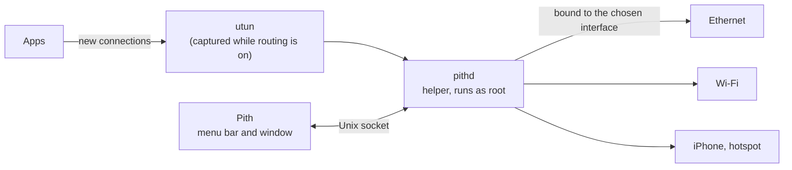

<div align="center">


# Pith

### Choose the network each app goes out through.

**WeChat over your phone's hotspot. The office intranet over Ethernet. Everything else as usual.**<br>
Rules by app, domain or IP send new connections out through the interface you pick,<br>
and Pith shows the interface every connection really used.

[](LICENSE) [](https://github.com/Kel077/pith/stargazers)<br>
  

**[Architecture](docs/ARCHITECTURE.md)** &nbsp;·&nbsp; **[Design](docs/DESIGN.md)** &nbsp;·&nbsp; **English** · [简体中文](README.zh-CN.md)

<br>


</div>

<br>

## Is Pith for you?

A Mac can be on Ethernet, Wi-Fi and a phone's hotspot at once, yet macOS sends nearly every connection through just one of them. Pith lets you choose, app by app and destination by destination:

- **Send an app through another network**: a chat app over the hotspot, a download tool over the second line, everything else as before.
- **Keep the intranet on the wire**: company hosts or a NAS over Ethernet, the rest over Wi-Fi.
- **Fall back, or don't**: a rule tries its interfaces in order; when none connects, macOS's own routing takes over, or the connection fails if you want the rule strict.
- **See where it went**: every connection with its app, its destination, the rule that decided and the interface it really left through.

It's for you if your Mac has more than one network at a time and some apps should use a particular one. If you only ever use one network, you don't need it.

Runs on Macs with Apple silicon and macOS 13 or later.

## Quick start

**1 · Build.** Pith isn't released yet. With [Go](https://go.dev/dl/) 1.27 or later:

```sh
git clone https://github.com/Kel077/pith.git
cd pith
go run ./cmd/pith          # the app, in the menu bar
go run ./cmd/pith -mock    # the interface on simulated data, nothing installed
```

<sub>The first time you turn routing on, macOS asks for an administrator's password to install Pith's helper, which does the routing. Settings → Helper removes it at any time.</sub>

**2 · Add a rule.** On **Rules**, choose **Add Rule**: the apps, the destinations (domains, IP addresses or ranges), and the interfaces to try, in order.

**3 · Turn routing on** from the menu bar or the sidebar. New connections follow the rules at once, and **Activity** shows where each one went.

## How it fits together



While routing is on, the helper captures new connections through a utun interface and a user-space network stack, finds the app each belongs to from the kernel's socket tables, and the domain from TLS SNI, the HTTP Host or DNS. It then makes the connection again, bound to the interface the rules choose, and relays the bytes. Turning routing off removes everything it added to the routing table. Pith needs no Apple developer account or system extension: macOS asks once for the password that installs the helper.

## What it does

### Rules as sentences

Each rule reads as what it does: these apps, to these places, go out through these interfaces, in this order.

| | |
| :-- | :-- |
| **Apps** | Any app, or the apps you pick. An app's helpers, and the system services that connect for it (WebKit, nsurlsessiond), match too |
| **Destinations** | Domains (with or without their subdomains), IP addresses and CIDR ranges, IPv4 and IPv6; paste a list to add many |
| **Interfaces** | An ordered list: the next one is tried when one can't connect, and then macOS's routing if you allow it |
| **Block** | Block rules always win; otherwise the first matching rule from the top decides. Drag to reorder |
| **Checks** | A rule that an earlier one fully covers says it never applies; **Check** tells which rule a connection would match, and where it would go now |

Saving applies the rules to new connections at once; open connections keep the route they have.

### Scenes

One set of rules for home, another for the office. Switch between them from the menu bar; the running scene shows a green dot.

### Activity

<table>
<tr>
<td width="68%"></td>
<td width="32%"></td>
</tr>
</table>

| | |
| :-- | :-- |
| **Connections** | Live, newest first: app, destination, protocol, the rule's interface in its color, or a quiet chip where macOS routed it. Right-click to make a rule from a connection |
| **Apps** | Traffic by app, with the interfaces each used |
| **Traffic** | Bytes through each interface over the last hour, day or week |

### Network

Every interface with its addresses, router and DNS; a test of its latency and public address; and one server reached through each interface, to compare them. Interfaces can be renamed.

### Also

- **Safe start**: if the Mac loses the internet right after routing starts, Pith undoes it.
- **Resume on launch**, **keep routing after quitting**, **open at login**, and the download speed in the menu bar.
- **Import and export** a scene's rules, or back up everything.
- **English and Simplified Chinese**, light and dark.

## Privacy

Pith reads where connections go — addresses, ports, and host names from TLS SNI, the HTTP Host or DNS — and never what they carry: no decryption, no certificates installed. Rules, the connection log and traffic totals stay on your Mac, and the log keeps as many days as Settings says. Pith sends nothing anywhere by itself; only a test you start on the Network page contacts [ipify](https://www.ipify.org) to learn an interface's public address.

## Documentation

| | |
| :-- | :-- |
| **[Architecture](docs/ARCHITECTURE.md)** | The app, the helper, the engine, and how they talk |
| **[Design](docs/DESIGN.md)** | The interface: its principles, colors and pages |
| **[Helper](internal/helper/README.md)** | What installing the helper changes, and its socket |
| **[Client](internal/client/README.md)** | The backend the interface talks to |

## License

[MIT](LICENSE)
