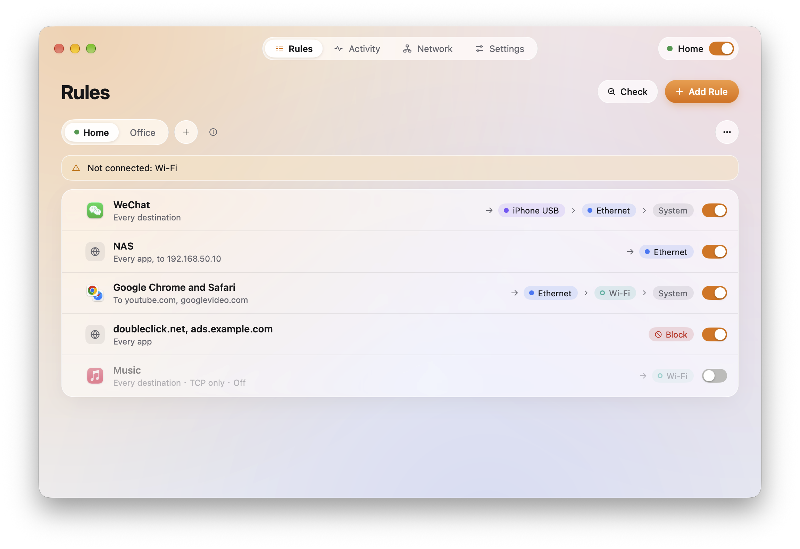
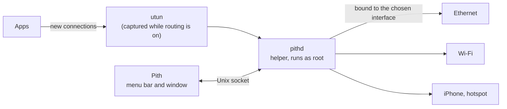
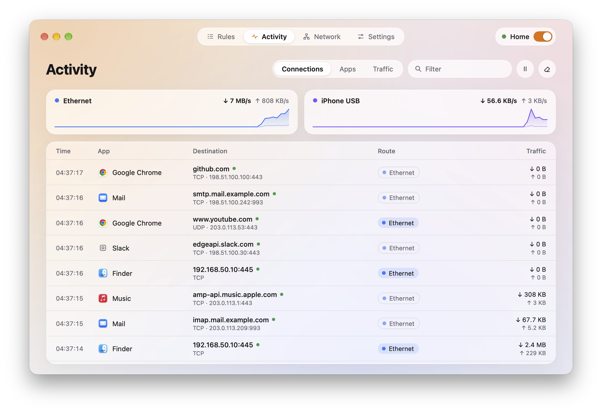
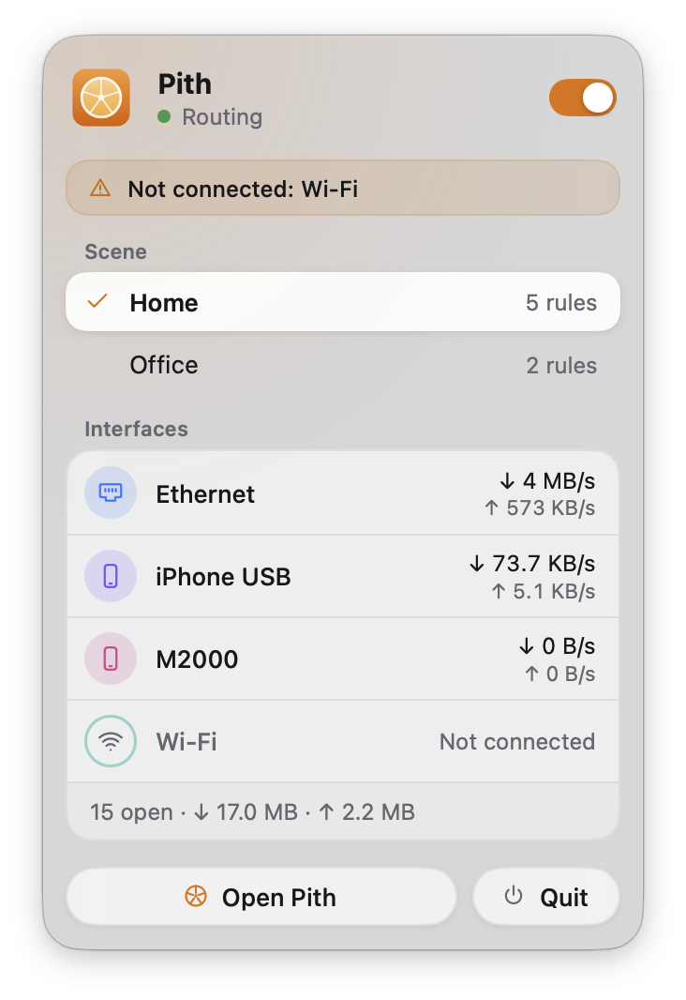

<div align="center">


# Pith

### Choose the network each app goes out through.

**WeChat over your phone's hotspot. The office intranet over Ethernet. Everything else as usual.**<br>
Write a few rules by app, domain or IP, and new connections leave through the interface you pick.<br>
You can also see which interface every connection really used.

[](LICENSE) [](https://github.com/Kel077/pith/stargazers) <a href="https://awesomemygo.dev/apps/pith"></a><br>
  

**[Architecture](docs/ARCHITECTURE.md)** &nbsp;·&nbsp; **[Design](docs/DESIGN.md)** &nbsp;·&nbsp; **English** · [简体中文](README.zh-CN.md)

<br>



</div>

<br>

## Is Pith for you?

A Mac can be on Ethernet, Wi-Fi and a phone's hotspot at the same time, but macOS sends almost everything through just one of them. Pith lets you decide, app by app and destination by destination:

- **Give one app its own line**: a chat app over the hotspot, a download tool over the second connection, everything else as before.
- **Keep the intranet on the wire**: company hosts or a NAS over Ethernet, the rest over Wi-Fi.
- **Switch lines when one fails**: a rule tries its interfaces in order, moving to the next when one can't connect; if none can, it hands the connection back to macOS, or drops it if you'd rather keep the rule strict.
- **See where everything went**: each connection with its app, its destination, the rule that matched and the interface it actually used.

If your Mac is often on more than one network and you want certain apps to stick to one of them, Pith is for you. If you only ever use one network, you won't need it.

Runs on Macs with Apple silicon and macOS 13 or later.

## Quick start

**1 · Install.** Download Pith from [Releases](https://github.com/Kel077/pith/releases/latest) and move it to Applications. Pith is signed ad hoc, not notarized by Apple, so macOS won't open it the first time: open System Settings → Privacy & Security, choose **Open Anyway** for Pith, and confirm.

<sub>To check a download, run `shasum -a 256 -c SHA256SUMS --ignore-missing` in the folder with the files, or `gh attestation verify <file> -R Kel077/pith`.</sub>

Or build it with [Go](https://go.dev/dl/) 1.27 or later:

```sh
git clone https://github.com/Kel077/pith.git
cd pith
make helper                # first, the helper that does the routing
go run ./cmd/pith          # the app, in the menu bar
go run ./cmd/pith -mock    # the interface on simulated data, nothing installed
```

<sub>The first time you turn routing on, macOS asks for an administrator's password to install Pith's helper, which does the routing. Settings → Helper removes it at any time.</sub>

**2 · Add a rule.** On **Rules**, choose **Add Rule**: the apps, the destinations (domains, IP addresses or ranges), and the interfaces to try, in order.

**3 · Turn routing on** from the menu bar, or with the switch at the top right of the window. New connections follow the rules at once, and **Activity** shows where each one went.

## How it fits together



While routing is on, the helper captures new connections through a utun interface and a user-space network stack, finds the app each belongs to from the kernel's socket tables, and the domain from TLS SNI, the HTTP Host or DNS. It then makes the connection again, bound to the interface the rules choose, and relays the bytes. Turning routing off removes everything it added to the routing table. Pith needs no Apple developer account or system extension. macOS asks for your password only to install, update or remove the helper; an update of the app alone, with the same helper, asks for nothing.

## What it does

### Rules as sentences

Each rule reads like a sentence: these apps, going to these places, leave through these interfaces, in this order.

| | |
| :-- | :-- |
| **Apps** | Any app, or the apps you pick. An app's helpers match too, and so do system processes that connect for it, such as Safari's WebKit networking process |
| **Destinations** | Domains (with or without their subdomains), IP addresses and CIDR ranges, IPv4 and IPv6; paste a list to add many |
| **Interfaces** | An ordered list: the next one is tried when one can't connect, and then macOS's routing if you allow it |
| **Block** | Block rules always win; otherwise the first matching rule from the top decides. Drag to reorder |
| **Checks** | A rule that an earlier one fully covers says it never applies; **Check** tells which rule a connection would match, and where it would go now |

Changes apply as soon as you save them. An open connection that the new rules send elsewhere, or block, is closed, and its app connects again under the new rules; the others keep going.

### Scenes

One set of rules for home, another for the office. Switch between them from the menu bar; the running scene shows a green dot.

### Activity

<table>
<tr>
<td width="68%"></td>
<td width="32%"></td>
</tr>
</table>

| | |
| :-- | :-- |
| **Connections** | Live, newest first: app, destination, protocol, the rule's interface in its color, or a quiet chip where macOS routed it. Right-click to make a rule from a connection |
| **Apps** | Traffic by app, with the interfaces each used |
| **Traffic** | Bytes through each interface over the last hour, day or week |

### Network

Every interface with its addresses, router and DNS; a test of its latency and public address; and one server reached through each interface, to compare them. Interfaces can be renamed.

Some hotspots also show their signal and can change their public IP. Only these, each tested on the device itself:

| Hotspot | Without its password | With its admin password |
| :-- | :-- | :-- |
| Inseego 5G MiFi M2000 | The bars, and 5G or LTE | Also the band in use (n41, n71…), the signal and the carrier, and **Change hotspot IP** |

**Change hotspot IP** has the hotspot reconnect to its carrier, which usually gives it a new public IP. Pith keeps the admin password in your keychain. Any other hotspot, other Inseego models included, still works for routing as an ordinary interface, without these extras.

### Also

- **Local proxies**: SOCKS5 ports on 127.0.0.1, TCP only, each going out through one interface. When that interface is down, connections through its port fail instead of using another. For apps and browsers that take a proxy, with routing on or off.
- **Safe start**, on by default: if the Mac loses the internet right after routing starts, Pith undoes it.
- **Resume routing on launch**, **Keep routing after quitting**, **Open at login**, and the download speed in the menu bar.
- **Import and export** a scene's rules, or back up everything.
- **English and Simplified Chinese**, light and dark.

## With a VPN or iCloud Private Relay

- **A VPN to your own devices**, like Tailscale without an exit node, is left alone: its traffic still goes through the VPN, and Pith doesn't touch its addresses or routes. If it disconnects and reconnects while routing is on, routing carries on: traffic meant for the VPN never leaves through another interface, and other apps stay online.
- **A VPN that carries all traffic**, like a Tailscale exit node, hasn't been tested with Pith yet.
- **iCloud Private Relay** sends Safari through Apple's relays, so Pith sees the relays instead of the sites, and domain and IP rules don't apply to Safari's browsing. To route Safari by site, turn Private Relay off.

## If you lose the internet

If the Mac loses the internet right after routing starts, Safe start undoes it by itself. If you're still offline:

1. **Turn Routing off** in the menu bar. This takes no password. Quitting Pith isn't enough while **Keep routing after quitting** is on.
2. **Remove the helper**: Settings → Helper → **Uninstall…**, with your administrator password. This also deletes the connection log and traffic totals; your rules stay.
3. **If Pith doesn't respond**, force quit it (⌥⌘⎋) and paste the block below into Terminal. It asks for your administrator password (nothing shows as you type) and has macOS stop Pith's helper, and nothing else: it runs no part of Pith, deletes no files and edits no routes. Then reopen Pith and remove the helper as in step 2; if you deleted Pith, install it again first. Until you do, the helper starts again with the Mac.

<details>
<summary>Stop the helper from Terminal</summary>

```sh
sudo /bin/sh <<'PITH_STOP'
set -eu
export LC_ALL=C
service='system/io.github.kel077.pith.helper'
fail() {
  printf '%s\n' 'Pith could not be stopped or its state could not be verified.' \
    'Keep any remaining files and capture journal. Stop here and open an issue:' \
    'https://github.com/Kel077/pith/issues/new' >&2
  exit 1
}
if state=$(/bin/launchctl print "$service" 2>&1); then
  /bin/launchctl bootout "$service" || fail
  printf '%s\n' 'macOS was asked to stop the Pith helper.'
else
  case "$state" in
    *'Could not find service "io.github.kel077.pith.helper"'*)
      printf '%s\n' 'Pith is not registered with launchd; nothing was changed.' ;;
    *) fail ;;
  esac
fi
printf '%s\n' 'No manual file or route deletion was performed.' \
  'Finish removal using the Uninstall action in Settings in a verified copy of Pith.'
PITH_STOP
```

If it reports an error, or you're still offline once the helper is removed, stop there and [open an issue](https://github.com/Kel077/pith/issues/new?template=bug.yml). Keep the helper's files, which record what Pith changed, but don't post them publicly. Don't delete routes by hand.

</details>

## Privacy

Pith reads where connections go: addresses, ports, and host names from TLS SNI, the HTTP Host or DNS. It never reads what they carry, decrypts nothing and installs no certificate. Rules, the connection log and traffic totals stay on your Mac, and the log keeps as many days as Settings says.

Pith connects to the internet on its own in one case: with Safe start on, each time routing starts, the helper opens one TLS connection to api.ipify.org to check the Mac is still online, and sends no request over it. Everything else is something you start: a test on the Network page asks [ipify](https://www.ipify.org) for an interface's public address, and reaching a server connects to the one you enter. With a hotspot's admin password, Pith reads the hotspot's own admin page, on your local network, while the Network page is open.

## Documentation

| | |
| :-- | :-- |
| **[Architecture](docs/ARCHITECTURE.md)** | The app, the helper, the engine, and how they talk |
| **[Design](docs/DESIGN.md)** | The interface: its principles, colors and pages |
| **[Helper](internal/helper/README.md)** | What installing the helper changes, and its socket |
| **[Client](internal/client/README.md)** | The backend the interface talks to |

## License

[MIT](LICENSE)
