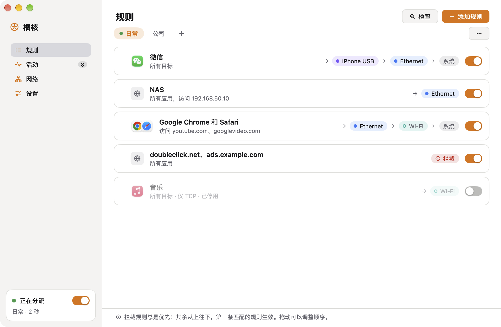
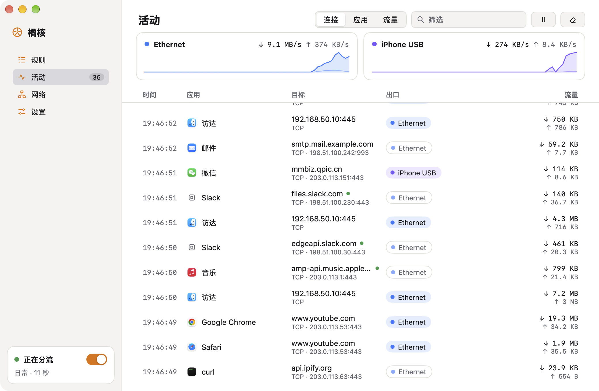
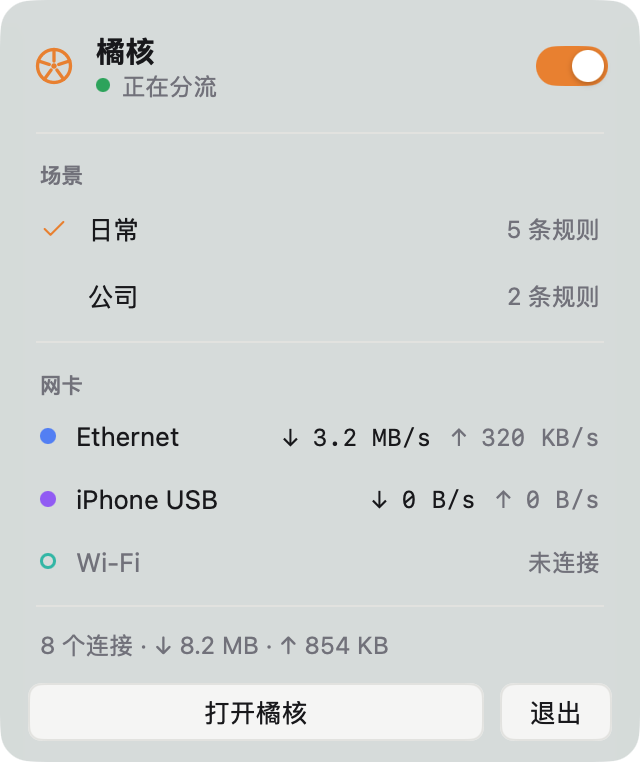

# 橘核 Pith

**为 Mac 上的每个应用选择网络出口。** 同时连着有线、Wi-Fi、手机热点时，橘核可以让指定的应用、域名或 IP 走你选的网卡，其余连接照常走系统网络。

*Choose the network exit of every app on your Mac — route connections by app, domain, IP or range through the interface you pick. [English below](#english).*

<p align="center">
  
</p>

## 功能

- **按应用、域名、IP / 网段分流**：一条规则读起来就是一句话：「微信 → iPhone USB，连不上时用以太网」。应用里的辅助进程、替它联网的系统服务（如 WebKit、nsurlsessiond）会一并匹配。
- **备选网卡与回退**：按顺序尝试多张网卡；都连不上时可以回退到系统网络，也可以直接失败（严格模式）。
- **拦截规则**：拦截规则总是优先，其余规则从上往下，第一条匹配的生效，拖动即可调整顺序。
- **场景**：家里、公司各一套规则，在菜单栏一键切换。规则保存后立即对新连接生效，不用重启分流。
- **活动**：实时查看每个连接的应用、目标、命中的规则和**实际出口网卡**；按应用汇总流量；1 小时 / 24 小时 / 7 天的流量统计。
- **网络**：查看每张网卡的地址、路由器、DNS，测试延迟和公网 IP，或者从每张网卡分别连接同一个服务器做对比。
- **规则检查**：输入应用和网址，看它会命中哪条规则、现在会从哪张网卡出去。
- **导入导出**：导出单个场景的规则，或备份全部配置。
- 中文 / English，浅色 / 深色模式。

<p align="center">
  
  
</p>

## 工作原理

橘核由两部分组成：

1. **橘核 App**（菜单栏 + 主窗口），用 [MyGo](https://github.com/egoist/mygo) 的原生 UI 编写，纯 Go、无 cgo。
2. **后台助手 `pithd`**，以管理员权限运行。打开分流时，它创建一个 utun 虚拟网卡接管新连接，识别连接属于哪个应用（读取内核的 socket 表）和哪个域名（TLS SNI / HTTP Host / DNS），再按规则把连接绑定到指定网卡（`IP_BOUND_IF`）发出去。关闭分流后，路由会完全恢复原样。

- 不解密 HTTPS，不读取、不记录传输内容，不上传任何数据；规则和日志只保存在本机。
- 不需要 Apple 开发者账号或系统扩展；第一次打开分流时，macOS 会要求输入一次管理员密码来安装助手，之后可以随时在设置里卸载。
- **安全启动**：开始分流后如果电脑断网，会自动撤销。

> 这不是防火墙，也不是 VPN：橘核只决定新连接从哪张网卡出去，不能把多条线路叠加成更快的一条，已建立的连接也不会自动迁移。在公司电脑上使用前，请先确认符合所在单位的网络安全规定。

## 系统要求

- Apple Silicon（M 系列）Mac
- macOS 13 或更新版本

## 从源码运行

需要 Go 1.27 或更新版本。

```sh
git clone https://github.com/Kel077/pith.git
cd pith
go run ./cmd/pith -mock   # 用模拟数据预览界面，不需要管理员权限
go test ./...
```

打包、安装后台助手的完整流程见 [docs/ARCHITECTURE.md](docs/ARCHITECTURE.md)（开发中）。

## 项目状态

开发中：界面、规则、网卡发现、应用识别、连通性测试和规则检查已经完成；后台助手和分流引擎正在开发。

## 许可

[MIT](LICENSE)

---

## English

**Pith** (橘核, "tangerine pip") picks the network exit of each app on your Mac. With Ethernet, Wi-Fi and a phone's hotspot connected at once, it sends the apps, domains or IP ranges you choose through the interface you choose, and leaves everything else to macOS.

- **Rules by app, domain, IP or range**, each read as a sentence: "WeChat → iPhone USB, else Ethernet". An app's helpers and the system services that connect for it (WebKit, nsurlsessiond) match too.
- **Fallbacks**: interfaces tried in order; when none connects, fall back to the system's network, or fail (strict).
- **Block rules** always win; otherwise the first matching rule from the top decides. Drag to reorder.
- **Scenes**: one set of rules for home, another for the office, switched from the menu bar. Saved rules apply to new connections at once.
- **Activity**: every connection with its app, destination, matching rule and **the interface it really used**; traffic per app; charts of the last hour, day or week.
- **Network**: each interface's addresses, router and DNS; latency and public IP tests; reach one server through every interface to compare.
- **Rule check**: see which rule a connection would match and where it would go now.
- Import and export rules, back up everything. English and Chinese, light and dark.

**How it works.** The app (menu bar and window) is written with [MyGo](https://github.com/egoist/mygo)'s native UI, in pure Go. A helper, `pithd`, runs as root: while routing is on, it captures new connections with a utun interface, attributes each to its app (from the kernel's socket tables) and its domain (TLS SNI, HTTP Host, DNS), and sends it out through the chosen interface with `IP_BOUND_IF`. Turning routing off restores the routes exactly. Pith never decrypts or records what apps send, and keeps rules and logs on your Mac. It needs no Apple developer account or system extension: macOS asks for an administrator's password once, to install the helper, which Settings can remove.

Pith is not a firewall or a VPN: it chooses the exit of new connections; it does not bond links into a faster one or move open connections.

**Requirements**: an Apple silicon Mac, macOS 13 or later. **Build**: Go 1.27+, `go run ./cmd/pith -mock` previews the interface with simulated data.

**Status**: in development — the interface, rules, interface discovery, app attribution, connectivity tests and the rule checker work; the helper and the routing engine are being built.

Licensed under [MIT](LICENSE).
