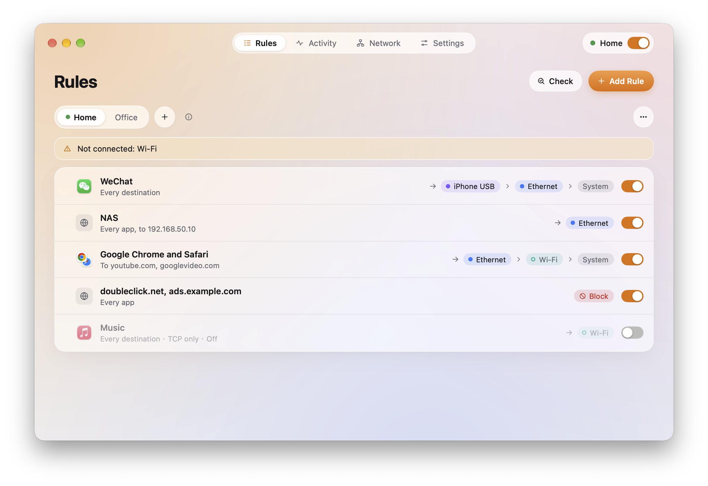
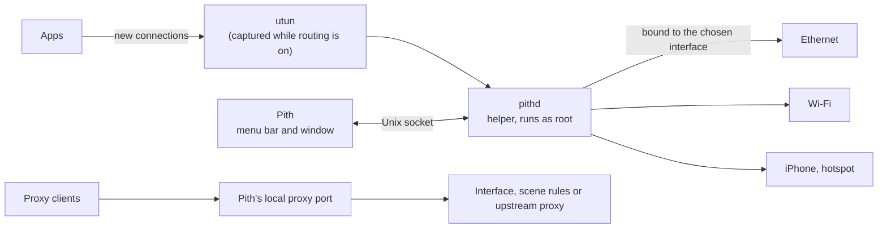

<div align="center">


# Pith

### Choose the network each app goes out through.

**WeChat over your phone's hotspot. The office intranet over Ethernet. Everything else as usual.**<br>
Write a few rules by app, domain or IP, and new connections leave through the interface you pick.<br>
Activity shows which interface each routed connection used.

[](LICENSE) [](https://github.com/Kel077/pith/stargazers) <a href="https://awesomemygo.dev/apps/pith"></a> [](https://linux.do)<br>
  

**[Architecture](docs/ARCHITECTURE.md)** &nbsp;·&nbsp; **[Design](docs/DESIGN.md)** &nbsp;·&nbsp; **English** · [简体中文](README.zh-CN.md)

<br>



</div>

<br>

## Is Pith for you?

A Mac can be on Ethernet, Wi-Fi and a phone's hotspot at the same time, but macOS sends almost everything through just one of them. Pith lets you decide, app by app and destination by destination:

- **Give one app its own line**: a chat app over the hotspot, a download tool over the second connection, everything else as before.
- **Keep the intranet on the wire**: company hosts or a NAS over Ethernet, the rest over Wi-Fi.
- **Switch lines when one fails**: a rule tries its interfaces in order, moving to the next when one can't connect; if none can, it hands the connection back to macOS, or drops it if you'd rather keep the rule strict.
- **See where everything went**: each connection with its app, its destination, the rule that matched and the interface it actually used.
- **Lend a line to your other devices**: a laptop, a phone or a tablet goes out through one of this Mac's networks, or by its rules.

Runs on Macs with Apple silicon and macOS 13 or later.

## Quick start

**1 · Install.** Download Pith from [Releases](https://github.com/Kel077/pith/releases/latest), move it to Applications and open it. Pith is signed ad hoc. If macOS blocks the first launch, open System Settings → Privacy & Security, choose **Open Anyway** for Pith and confirm.

<sub>To check a download, put it beside `SHA256SUMS` and run `shasum -a 256 -c SHA256SUMS --ignore-missing`. To verify its build provenance, use `gh attestation verify <file> -R Kel077/pith`.</sub>

The features listed under **Unreleased** are in the source build. To build the app and its helper on an Apple silicon Mac with Go 1.27 and the Command Line Tools, run the following. [Changelog](CHANGELOG.md#unreleased) · [Build instructions](docs/BUILDING.md)

```sh
git clone https://github.com/Kel077/pith.git
cd pith
make build
open build/darwin-arm64/Pith.app
```

**2 · Add a rule.** Open **Rules → Add Rule**. Pick an app, a destination or both. Choose the interfaces to try, in order.

**3 · Turn on routing.** Use the switch in the menu bar or at the top right of the window. The first time, macOS asks for an administrator password to install the helper. Open **Activity** to see where a new connection went.

To give just one browser an explicit proxy, open **Settings → Local proxies → Add Proxy**. Enter the displayed address and port in the browser's proxy settings. This works with routing off.

## How it fits together



While routing is on, the helper receives captured connections through a utun interface. It looks up their apps in the kernel's socket tables and uses the rules to choose an interface. Turning routing off removes its capture routes. Explicit proxy ports run in the menu bar app. Pith needs no system extension. An app update that keeps the same helper needs no administrator approval.

## What it does

### Rules and scenes

| Match or action | What it does |
| :-- | :-- |
| **Apps** | Match every app, or pick apps and command-line tools. Pith can match a helper or a system process when macOS identifies the app it connects for. |
| **Destinations** | Match an exact domain, a domain with its subdomains, an IPv4 or IPv6 address, or a CIDR range. Paste several destinations at once. Limit a rule to TCP or UDP if needed. |
| **Route or block** | Block rules win. The first matching route rule tries its interfaces in order. If all fail, the rule can drop the connection or let macOS choose the route. |
| **Order and check** | Drag rules to reorder them. Pith flags rules that can never decide, including routes fully covered by a block anywhere in the list. **Check** previews the decision for an app and destination and shows the predicted interface. |

Keep one scene for home and another for work. Create, duplicate, rename or delete scenes on **Rules**. The green dot marks the running scene. Switch scenes from the menu bar, or edit another scene while the current one runs. The scene menu imports and exports its rules.

Saving a change to the running scene applies it to new connections. Pith closes the connections it handles whose routing decision changes, so their apps can reconnect.

### Activity

<table>
<tr>
<td width="68%"></td>
<td width="32%"></td>
</tr>
</table>

| View | What it shows |
| :-- | :-- |
| **Connections** | See the app, destination, protocol, matched rule, actual interface and bytes for connections handled by routing. Filter or pause the list. Right-click a connection to make a rule for its app or destination. |
| **Apps** | Compare traffic by app and see which interfaces each used. |
| **Traffic** | Compare bytes by interface over the last hour, day or week. The menu bar panel shows each interface's current upload and download rates. |

### Network

The **Network** page shows connected interfaces, their addresses, router and DNS servers. A chip marks the system default. Double-click an interface's name to give it a label in Pith.

| Test | What you get |
| :-- | :-- |
| **Test speed** | Latency in milliseconds, download and upload speeds in Mbps, and the public IP and data center reported by Cloudflare. A full test uses about 33 MB per interface (25 MB down, 8 MB up). **Test All** runs the connected interfaces in sequence. |
| **Reach a server** | Enter a host and port, such as `example.com:443`. Pith opens a TCP connection through each connected interface and shows the time and destination address or the error. |

Both tests use the chosen interface for DNS and the connection. If its DNS servers fail, Pith can try eligible resolvers from the Mac's DNS configuration through that interface.

#### Change a public IP

| Device | On its Network card |
| :-- | :-- |
| **Inseego 5G MiFi M2000** | See signal bars and network type. Unlock with the hotspot's admin password for carrier, band, signal strength and **Change hotspot IP**. The hotspot reconnects to its carrier. Pith waits for a fresh cellular session when the device reports its age, then checks the public addresses again. |
| **Verizon Router CHR30A-R (Fios)** | On Ethernet or Wi-Fi, Pith shows the model beside the router address. Choose **Change IP** and enter the router's admin password to unlock it. Choose **Change IP** on the unlocked card to renew the WAN IPv4 lease. |

Router renewal needs the helper and another connected network with internet access. Pith waits for macOS to select a working standby before releasing the lease. Rules with other exits can use them, and direct proxies on the renewing interface close their streams. The router's clients lose internet access during each release.

If Verizon returns the same IPv4 address, Pith tries again, with pauses of 5, 20 and 60 seconds across at most three attempts. It only renews IPv4. With either device, the provider can return the old address.

Device passwords stay in the macOS keychain. Other models can still serve as ordinary routing interfaces.

### Local proxies

Open **Settings → Local proxies → Add Proxy**. Pith suggests ports starting at `1080`. Double-click the displayed address to edit the port. Each port accepts SOCKS5, HTTP CONNECT and plain HTTP on TCP. It works while Pith is open, with or without the routing helper.

| Exit | Where the connection goes |
| :-- | :-- |
| **An interface** | Through one physical network. Connections fail if that interface goes down. Names sent to the proxy are resolved through that interface. |
| **Rules: *scene*** | By the destination rules of any saved scene. Blocks, ordered interfaces and fallback apply. Unmatched traffic follows macOS. Rules restricted to particular apps are skipped. Rule edits apply to new proxy connections. |
| **Another proxy…** | Through a SOCKS5 proxy that accepts connections without authentication, including a port shared by another Mac's Pith. The upstream resolves destination names. |

Each row shows its connections and traffic. Quitting Pith closes its proxy ports, including when **Keep routing after quitting** is on.

### Other devices

1. Choose **Share with devices** on the proxy's row. On the other device, use an IPv4 address shown under **Devices → This Mac** and the proxy's port. A phone or tablet can use its Wi-Fi HTTP proxy setting.
2. Choose **Add Device** and enter the device's IPv4 address or CIDR range. Or let the device connect once and choose **Allow** beside its refused attempt. The same device list applies to all shared ports.
3. To keep another Mac's apps pointed at their local ports, set their Pith port's exit to **Another proxy…** and enter the sharing Mac's address and port.

Shared ports identify clients by source IP. Allow devices on networks you trust. They can reach other hosts on the exit's local network. Pith checks destination addresses against the Mac's own interfaces. An upstream resolves names on its own machine, and a shared port requires its upstream to be on another machine.

### For scripts

Send these HTTP requests directly to a configured port. Replace `1080` with the port shown in Settings.

```sh
curl --noproxy '*' 'http://127.0.0.1:1080/?max-age=60'
curl --noproxy '*' -X POST http://127.0.0.1:1080/change-ip
```

| Request | JSON response |
| :-- | :-- |
| `GET /` | Exit type, online state, public addresses when known, and whether a change can be requested. A scene has no single public IP. `max-age` asks for addresses at most that many seconds old. |
| `POST /change-ip` | The old and observed public addresses after a renewal. Enable **Let apps and devices change its IP** to allow this on the port. Every permitted caller can then request a renewal. |

A plain GET reuses cached addresses. After an incomplete or failed lookup, later reads can retry after 30 seconds, with the interval doubling up to ten minutes. Requests for the same interface share one renewal. A change on another interface on that Mac returns `503` with `busy` until it finishes.

A Pith upstream relays both requests. A POST needs permission at each hop. The local row can show the upstream's interface and public IP. Its **Change IP** button uses the upstream's permission even when the local port's POST is disabled.

Use an IP address, `localhost`, a single-label name or a `.local` name. The port checks the Host and browser request headers. Lookup retries, response fields, timeouts and HTTP errors are in the [port reference](docs/ARCHITECTURE.md#requests-to-a-port).

### For agents

An MCP client can work with the Pith app you have open. Add the app's executable as a stdio server with the argument `mcp`. For a copy installed in Applications, use the command for your client.

```sh
claude mcp add pith -- /Applications/Pith.app/Contents/MacOS/Pith mcp
codex mcp add pith -- /Applications/Pith.app/Contents/MacOS/Pith mcp
```

Ask it to check where an app would connect, test an interface, or show traffic. It can add and reorder rules, manage scenes, switch routing, configure proxies, allow devices and request an IP change. Configuration edits appear in the window. A renewal can take several minutes.

Only programs running as your user can call the open app over its Unix socket. For a remote Mac, run the same command there over SSH. Tool calls can change routing without a second prompt from Pith. Set permissions in your MCP client. Helper installation, device passwords and editing Settings are handled in the app. [Tool names and connection details](docs/ARCHITECTURE.md#tools-for-agents)

### Settings

**Safe start** checks internet access when routing starts and rolls back a failed start. It is on by default. Settings also controls IPv6 routing, domain recognition, log retention, opening at login, resuming routing on launch, keeping it on after quitting and showing the download rate in the menu bar.

**Back up everything** exports and restores scenes, rules, interface aliases, proxies, allowed devices and settings. The app follows the system's light or dark appearance and supports English and Simplified Chinese.

## With a VPN or iCloud Private Relay

- **A VPN to your own devices**, like Tailscale without an exit node, is left alone: its traffic still goes through the VPN, and Pith doesn't touch its addresses or routes. If it disconnects and reconnects while routing is on, routing carries on: traffic meant for the VPN never leaves through another interface, and other apps stay online.
- **A VPN that carries all traffic**, like a Tailscale exit node, hasn't been tested with Pith yet.
- **iCloud Private Relay** sends Safari through Apple's relays, so Pith sees the relays instead of the sites, and domain and IP rules don't apply to Safari's browsing. To route Safari by site, turn Private Relay off.

## If you lose the internet

If the Mac loses the internet right after routing starts, Safe start undoes it by itself. If you're still offline:

1. **Turn Routing off** in the menu bar. This takes no password. Quitting Pith isn't enough while **Keep routing after quitting** is on.
2. **Remove the helper**: Settings → Helper → **Uninstall…**, with your administrator password. This also deletes the connection log and traffic totals; your rules stay.
3. **If Pith doesn't respond**, force quit it (⌥⌘⎋) and paste the block below into Terminal. It asks for your administrator password (nothing shows as you type) and has macOS stop Pith's helper, and nothing else: it runs no part of Pith, deletes no files and edits no routes. Then reopen Pith and remove the helper as in step 2; if you deleted Pith, install it again first. Until you do, the helper starts again with the Mac.

<details>
<summary>Stop the helper from Terminal</summary>

```sh
sudo /bin/sh <<'PITH_STOP'
set -eu
export LC_ALL=C
service='system/io.github.kel077.pith.helper'
fail() {
  printf '%s\n' 'Pith could not be stopped or its state could not be verified.' \
    'Keep any remaining files and capture journal. Stop here and open an issue:' \
    'https://github.com/Kel077/pith/issues/new' >&2
  exit 1
}
if state=$(/bin/launchctl print "$service" 2>&1); then
  /bin/launchctl bootout "$service" || fail
  printf '%s\n' 'macOS was asked to stop the Pith helper.'
else
  case "$state" in
    *'Could not find service "io.github.kel077.pith.helper"'*)
      printf '%s\n' 'Pith is not registered with launchd; nothing was changed.' ;;
    *) fail ;;
  esac
fi
printf '%s\n' 'No manual file or route deletion was performed.' \
  'Finish removal using the Uninstall action in Settings in a verified copy of Pith.'
PITH_STOP
```

If it reports an error, or you're still offline once the helper is removed, stop there and [open an issue](https://github.com/Kel077/pith/issues/new?template=bug.yml). Keep the helper's files, which record what Pith changed, but don't post them publicly. Don't delete routes by hand.

</details>

## Privacy

Pith reads connection metadata and can recognize names from DNS, TLS, HTTP and QUIC. It does not decrypt HTTPS or install a certificate. Its configuration, connection log and traffic totals are stored on the Mac. Settings controls how long the connection log is kept.

With **Safe start** on, starting routing opens a verified TLS connection to ipify. **Test speed** contacts Cloudflare. **Reach a server** connects to the host and port you enter. Public-address probes use ipify during renewals and when a proxy needs fresh exit information. An enabled Pith-to-Pith proxy can request that information automatically as it checks its upstream. The Network page reads supported gateways on the local network, including their model or signal before you unlock them. [Network and probe details](docs/ARCHITECTURE.md#network-tests)

## Documentation

| Document | Contents |
| :-- | :-- |
| [Architecture](docs/ARCHITECTURE.md) | Routing, DNS, proxies, public-IP changes and MCP. |
| [Interface design](docs/DESIGN.md) | The window, menu bar panel and controls. |
| [Building](docs/BUILDING.md) | Build the app, run the mock and verify a package. |
| [Client](internal/client/README.md) · [Helper](internal/helper/README.md) · [Helper versioning](docs/HELPER-VERSIONING.md) | App services, privileged IPC and helper updates. |
| [Performance](docs/PERFORMANCE.md) | Relay benchmarks and how to read the measurements. |
| [Hardware tests](docs/ROOT-TEST.md) · [Acceptance plan](docs/NEXT-ACCEPTANCE.md) | Recorded results, their scope and outstanding checks. |
| [Changelog](CHANGELOG.md) | Released and unreleased changes. |

## License

[MIT](LICENSE)
