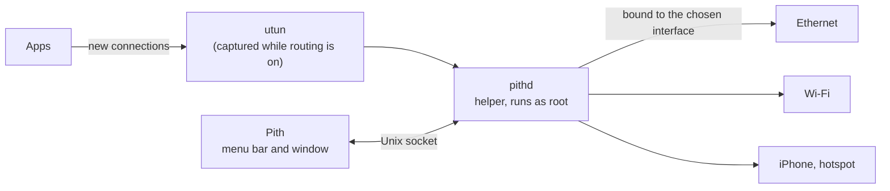
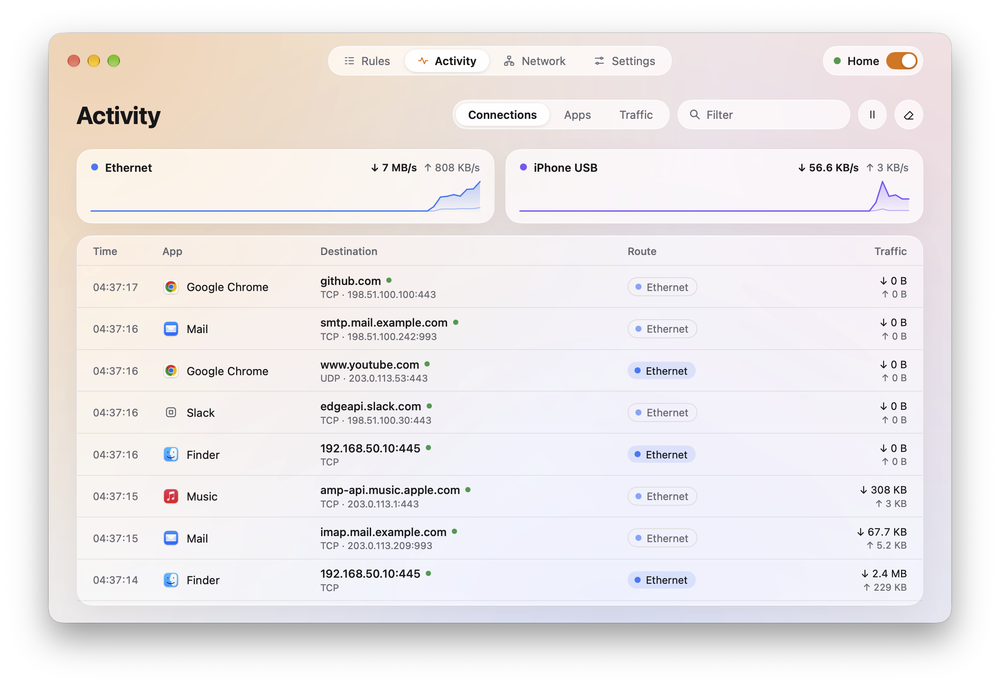
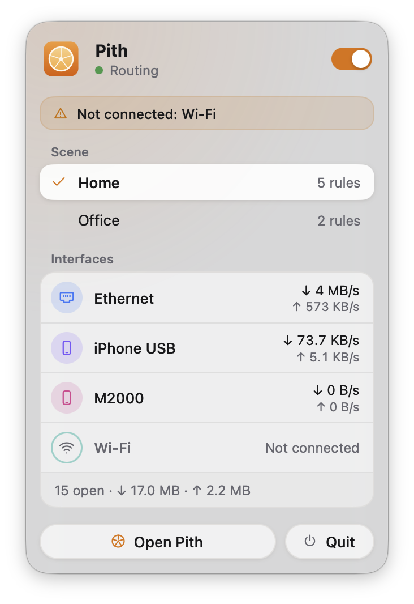

<div align="center">


# Pith

### Choose the network each app goes out through.

**WeChat over your phone's hotspot. The office intranet over Ethernet. Everything else as usual.**<br>
Write a few rules by app, domain or IP, and new connections leave through the interface you pick.<br>
You can also see which interface every connection really used.

[](LICENSE) [](https://github.com/Kel077/pith/stargazers) <a href="https://awesomemygo.dev/apps/pith"></a> [](https://linux.do)<br>
  

**[Architecture](docs/ARCHITECTURE.md)** &nbsp;·&nbsp; **[Design](docs/DESIGN.md)** &nbsp;·&nbsp; **English** · [简体中文](README.zh-CN.md)

<br>


</div>

<br>

## Is Pith for you?

A Mac can be on Ethernet, Wi-Fi and a phone's hotspot at the same time, but macOS sends almost everything through just one of them. Pith lets you decide, app by app and destination by destination:

- **Give one app its own line**: a chat app over the hotspot, a download tool over the second connection, everything else as before.
- **Keep the intranet on the wire**: company hosts or a NAS over Ethernet, the rest over Wi-Fi.
- **Switch lines when one fails**: a rule tries its interfaces in order, moving to the next when one can't connect; if none can, it hands the connection back to macOS, or drops it if you'd rather keep the rule strict.
- **See where everything went**: each connection with its app, its destination, the rule that matched and the interface it actually used.
- **Lend a line to your other devices**: a laptop, a phone or a tablet goes out through one of this Mac's networks, or by its rules.

If your Mac is often on more than one network and you want certain apps to stick to one of them, Pith is for you. If you only ever use one network, you won't need it.

Runs on Macs with Apple silicon and macOS 13 or later.

## Quick start

**1 · Install.** Download Pith from [Releases](https://github.com/Kel077/pith/releases/latest) and move it to Applications. Pith is signed ad hoc, not notarized by Apple, so macOS won't open it the first time: open System Settings → Privacy & Security, choose **Open Anyway** for Pith, and confirm.

<sub>To check a download, run `shasum -a 256 -c SHA256SUMS --ignore-missing` in the folder with the files, or `gh attestation verify <file> -R Kel077/pith`.</sub>

Or build it with [Go](https://go.dev/dl/) 1.27 or later:

```sh
git clone https://github.com/Kel077/pith.git
cd pith
make helper                # first, the helper that does the routing
go run ./cmd/pith          # the app, in the menu bar
go run ./cmd/pith -mock    # the interface on simulated data, nothing installed
```

<sub>The first time you turn routing on, macOS asks for an administrator's password to install Pith's helper, which does the routing. Settings → Helper removes it at any time.</sub>

**2 · Add a rule.** On **Rules**, choose **Add Rule**: the apps, the destinations (domains, IP addresses or ranges), and the interfaces to try, in order.

**3 · Turn routing on** from the menu bar, or with the switch at the top right of the window. New connections follow the rules at once, and **Activity** shows where each one went.

## How it fits together



While routing is on, the helper captures new connections through a utun interface and a user-space network stack, finds the app each belongs to from the kernel's socket tables, and the domain from TLS SNI, the HTTP Host or DNS. It then makes the connection again, bound to the interface the rules choose, and relays the bytes. Turning routing off removes everything it added to the routing table. Pith needs no Apple developer account or system extension. macOS asks for your password only to install, update or remove the helper; an update of the app alone, with the same helper, asks for nothing.

## What it does

### Rules as sentences

Each rule reads like a sentence: these apps, going to these places, leave through these interfaces, in this order.

| | |
| :-- | :-- |
| **Apps** | Any app, or the apps you pick. An app's helpers match too, and so do system processes that connect for it, such as Safari's WebKit networking process |
| **Destinations** | Domains (with or without their subdomains), IP addresses and CIDR ranges, IPv4 and IPv6; paste a list to add many |
| **Interfaces** | An ordered list: the next one is tried when one can't connect, and then macOS's routing if you allow it |
| **Block** | Block rules always win; otherwise the first matching rule from the top decides. Drag to reorder |
| **Checks** | A rule that an earlier one fully covers says it never applies; **Check** tells which rule a connection would match, and where it would go now |

Changes apply as soon as you save them. An open connection that the new rules send elsewhere, or block, is closed, and its app connects again under the new rules; the others keep going.

### Scenes

One set of rules for home, another for the office. Switch between them from the menu bar; the running scene shows a green dot.

### Activity

<table>
<tr>
<td width="68%"></td>
<td width="32%"></td>
</tr>
</table>

| | |
| :-- | :-- |
| **Connections** | Live, newest first: app, destination, protocol, the rule's interface in its color, or a quiet chip where macOS routed it. Right-click to make a rule from a connection |
| **Apps** | Traffic by app, with the interfaces each used |
| **Traffic** | Bytes through each interface over the last hour, day or week |

### Network

Every interface with its addresses, router and DNS; a speed test of its latency, download and upload, which also finds its public address; and one server reached through each interface, to compare them. Interfaces can be renamed.

Some hotspots also show their signal and can change their public IP. Only these, each tested on the device itself:

| Hotspot | Without its password | With its admin password |
| :-- | :-- | :-- |
| Inseego 5G MiFi M2000 | The bars, and 5G or LTE | Also the band in use (n41, n71…), the signal and the carrier, and **Change hotspot IP** |

**Change hotspot IP** has the hotspot reconnect to its carrier, which usually gives it a new public IP. Pith keeps the admin password in your keychain. Any other hotspot, other Inseego models included, still works for routing as an ordinary interface, without these extras.

A router can change its public IP too, when Pith has its admin password. Only this one, tested on the device itself:

| Router | With its admin password |
| :-- | :-- |
| Verizon Router CHR30A-R (Fios) | Its model beside its address, and **Change IP** on the card of the Ethernet or Wi-Fi it serves |

**Change IP** has the router give its public IPv4 address up and ask Verizon for another, waiting longer each time Verizon gives the same one back, three times at most; it took 34 seconds in a test. Meanwhile your Mac goes through another connected network, which macOS makes the default; rules skip the router's interface, and local proxies through that interface refuse connections rather than use another. Everything else on the router's network is offline meanwhile, for 5 seconds on the first try, 20 on the second and a minute on the third, plus the time the router takes to connect again, and connections through the old address end. The public IPv6 address doesn't change. Pith needs another network with internet to do it, and its helper, which makes that network the default meanwhile.

### Local proxies

A local proxy is a port on your Mac for apps and browsers that take a proxy, with routing on or off. It speaks SOCKS5 and HTTP, TCP only, and goes out one of three ways:

| | |
| :-- | :-- |
| **Through one interface** | Everything through that network. When it is down, connections fail instead of using another |
| **By a scene's rules** | Each connection where that scene's rules send it: a block rule refuses it, a rule's interfaces are tried in order, and what no rule matches goes where macOS sends it. Rules that name apps are left out: a proxy can't tell which app a connection is for |
| **Through another proxy** | Through a port another Mac's Pith shares, or any SOCKS5 proxy without a password, by its host and port |

### Other devices

**Share** a local proxy, and the devices listed under **Devices** can use it at your Mac's address: another computer, or a phone or tablet whose Wi-Fi settings take an HTTP proxy. A device is listed by its IPv4 address, or a range of them. One that isn't listed is refused, and appears under **Devices** with **Allow** beside it. Each device shows its open connections and what it has moved.

Another Mac can keep its own ports: in its Pith, a local proxy goes out through **Another proxy…**, your Mac's shared port, and the apps there still connect to `127.0.0.1`.

Sharing asks for no password. Any device that can use a listed address can use the port, and reaches what your Mac reaches through it, its local network included, though not your Mac itself: share on networks you trust. A shared proxy can't go out through a proxy on the same Mac.

### For scripts

A local proxy's port also answers two plain HTTP requests made to the port itself, for a script or a tool that drives browsers through it:

| | |
| :-- | :-- |
| `GET /` | What the port goes out through, whether it is online, and the public IP addresses the internet sees it by, as JSON |
| `POST /change-ip` | Changes that public IP, as **Change hotspot IP** and **Change IP** do on the Network page, and answers with the old and the new address once it is done |

```sh
curl http://127.0.0.1:1081/
curl -X POST http://127.0.0.1:1081/change-ip
```

Whatever can use the port can ask `GET /`. Pith looks the addresses up once and keeps them until the network changes; `GET /?max-age=60` has them looked up again when they are older than a minute. When a lookup fails, or finds only an IPv4 or only an IPv6 address where the network has both, a plain `GET /` waits 30 seconds before Pith tries again, then longer each time.

`POST /change-ip` is refused until you turn on **Let apps and devices change its IP**, the button with two arrows on the proxy's row. Then every app on your Mac, and every device the proxy is shared with, can change that IP. A router that changes its IP takes everything on its network offline, from seconds to over a minute: think of who else is on it.

Pith changes one network's IP at a time, so that the network carrying your Mac while a router renews stays up: while another network's IP is being changed, `POST /change-ip` is answered `503`. Try again once that is done.

A proxy that goes out through another Mac's Pith passes both requests on to it; a change needs the button on in both. Its row names the network the other Mac uses and its public IP, with **Change IP** beside them when the other Mac allows it.

Pith answers only requests that name the port by an IP address, `localhost`, a name without dots or a `.local` name, and refuses those a page in a browser makes, even a page whose own name was pointed at your Mac. A device that asks by a full domain name, such as `mac.example.com`, is refused too: use your Mac's address, or its name on the local network.

### For agents

An AI agent that speaks the [Model Context Protocol](https://modelcontextprotocol.io), as Claude Code and Codex do, can work Pith for you: ask it to send an app through another network, to add or change rules, to set up a local proxy, or to change a network's IP. Pith's own executable is the server. Add it to the agent with the argument `mcp`:

```sh
claude mcp add pith -- /Applications/Pith.app/Contents/MacOS/Pith mcp
codex mcp add pith -- /Applications/Pith.app/Contents/MacOS/Pith mcp
```

An agent that takes its servers as JSON takes `{"command": "/Applications/Pith.app/Contents/MacOS/Pith", "args": ["mcp"]}`.

| The agent can | |
| :-- | :-- |
| **Read** | Whether routing is on, the scenes and their rules, the interfaces, the installed apps, the connections and the traffic; test an interface and its speed; check which rule a connection would match |
| **Change** | Add, change, move and remove rules and scenes; turn routing on or off, or to another scene; add, change and remove local proxies, and the devices that may use the shared ones |
| **Change IP** | Of the hotspot or the router behind an interface, or of what a local proxy goes out through |

What an agent changes shows in Pith at once, and applies as your own changes do. It works the Pith that is open: while Pith is closed, the tools answer that it isn't running. Some things stay yours: installing the helper, which takes your password, the admin passwords of hotspots and routers, and Pith's settings.

Only programs that run as you on this Mac reach the tools: Pith opens no network port for them. To work another Mac's Pith, have the agent start it there over SSH: `ssh other-mac /Applications/Pith.app/Contents/MacOS/Pith mcp`.

Changing an IP can take over a minute, longer than some agents wait for a tool. Codex waits as long as `tool_timeout_sec = 180` says, under `[mcp_servers.pith]` in its configuration.

The tools do what you could do in Pith, without asking you again. An agent that also reads web pages or other people's files can be talked into things by what it reads: allow it the tools that change something as far as you trust it. Pith tells the agent which tools only read, so that it can ask you before the others.

### Also

- **Safe start**, on by default: if the Mac loses the internet right after routing starts, Pith undoes it.
- **Resume routing on launch**, **Keep routing after quitting**, **Open at login**, and the download speed in the menu bar.
- **Import and export** a scene's rules, or back up everything.
- **English and Simplified Chinese**, light and dark.

## With a VPN or iCloud Private Relay

- **A VPN to your own devices**, like Tailscale without an exit node, is left alone: its traffic still goes through the VPN, and Pith doesn't touch its addresses or routes. If it disconnects and reconnects while routing is on, routing carries on: traffic meant for the VPN never leaves through another interface, and other apps stay online.
- **A VPN that carries all traffic**, like a Tailscale exit node, hasn't been tested with Pith yet.
- **iCloud Private Relay** sends Safari through Apple's relays, so Pith sees the relays instead of the sites, and domain and IP rules don't apply to Safari's browsing. To route Safari by site, turn Private Relay off.

## If you lose the internet

If the Mac loses the internet right after routing starts, Safe start undoes it by itself. If you're still offline:

1. **Turn Routing off** in the menu bar. This takes no password. Quitting Pith isn't enough while **Keep routing after quitting** is on.
2. **Remove the helper**: Settings → Helper → **Uninstall…**, with your administrator password. This also deletes the connection log and traffic totals; your rules stay.
3. **If Pith doesn't respond**, force quit it (⌥⌘⎋) and paste the block below into Terminal. It asks for your administrator password (nothing shows as you type) and has macOS stop Pith's helper, and nothing else: it runs no part of Pith, deletes no files and edits no routes. Then reopen Pith and remove the helper as in step 2; if you deleted Pith, install it again first. Until you do, the helper starts again with the Mac.

<details>
<summary>Stop the helper from Terminal</summary>

```sh
sudo /bin/sh <<'PITH_STOP'
set -eu
export LC_ALL=C
service='system/io.github.kel077.pith.helper'
fail() {
  printf '%s\n' 'Pith could not be stopped or its state could not be verified.' \
    'Keep any remaining files and capture journal. Stop here and open an issue:' \
    'https://github.com/Kel077/pith/issues/new' >&2
  exit 1
}
if state=$(/bin/launchctl print "$service" 2>&1); then
  /bin/launchctl bootout "$service" || fail
  printf '%s\n' 'macOS was asked to stop the Pith helper.'
else
  case "$state" in
    *'Could not find service "io.github.kel077.pith.helper"'*)
      printf '%s\n' 'Pith is not registered with launchd; nothing was changed.' ;;
    *) fail ;;
  esac
fi
printf '%s\n' 'No manual file or route deletion was performed.' \
  'Finish removal using the Uninstall action in Settings in a verified copy of Pith.'
PITH_STOP
```

If it reports an error, or you're still offline once the helper is removed, stop there and [open an issue](https://github.com/Kel077/pith/issues/new?template=bug.yml). Keep the helper's files, which record what Pith changed, but don't post them publicly. Don't delete routes by hand.

</details>

## Privacy

Pith reads where connections go: addresses, ports, and host names from TLS SNI, the HTTP Host or DNS. It never reads what they carry, decrypts nothing and installs no certificate. Rules, the connection log and traffic totals stay on your Mac, and the log keeps as many days as Settings says.

Pith connects to the internet on its own in one case: with Safe start on, each time routing starts, the helper opens one TLS connection to api.ipify.org to check the Mac is still online, and sends no request over it. Everything else is something you start: a speed test on the Network page downloads 25 MB from and uploads 8 MB to [Cloudflare's speed test](https://speed.cloudflare.com), which also tells the public address it saw; changing a hotspot's or a router's IP asks [ipify](https://www.ipify.org) for its public addresses before and after, as it does when a script or another Mac's Pith asks a local proxy's port for them and Pith knows none, or `max-age` finds them too old; and reaching a server connects to the one you enter. With a hotspot's or a router's admin password, Pith reads the device's own admin page, on your local network, while the Network page is open; and when a local proxy's port is first asked about itself, Pith looks at its network's router once, to tell whether it is one whose IP it can change.

## Documentation

| | |
| :-- | :-- |
| **[Architecture](docs/ARCHITECTURE.md)** | The app, the helper, the engine, and how they talk |
| **[Design](docs/DESIGN.md)** | The interface: its principles, colors and pages |
| **[Helper](internal/helper/README.md)** | What installing the helper changes, and its socket |
| **[Client](internal/client/README.md)** | The backend the interface talks to |

## License

[MIT](LICENSE)
