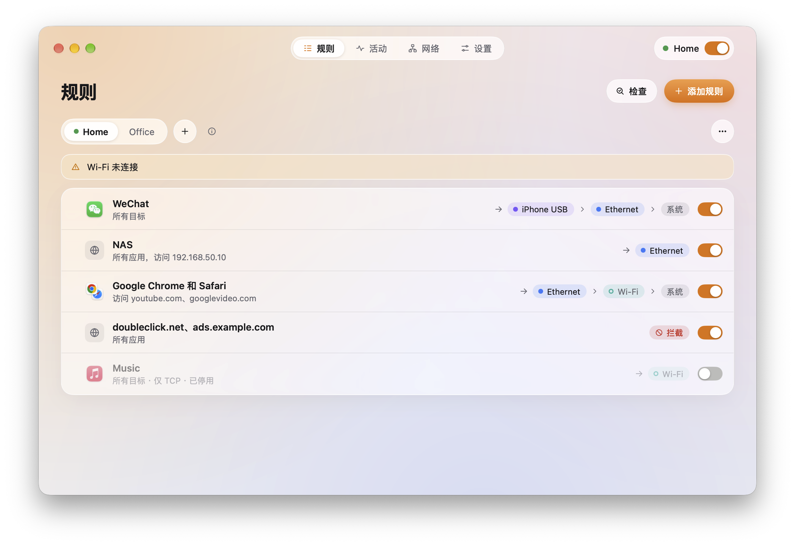
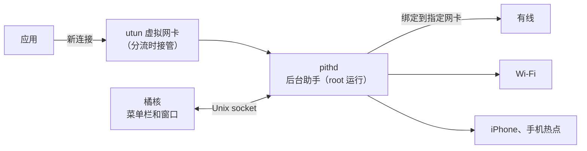
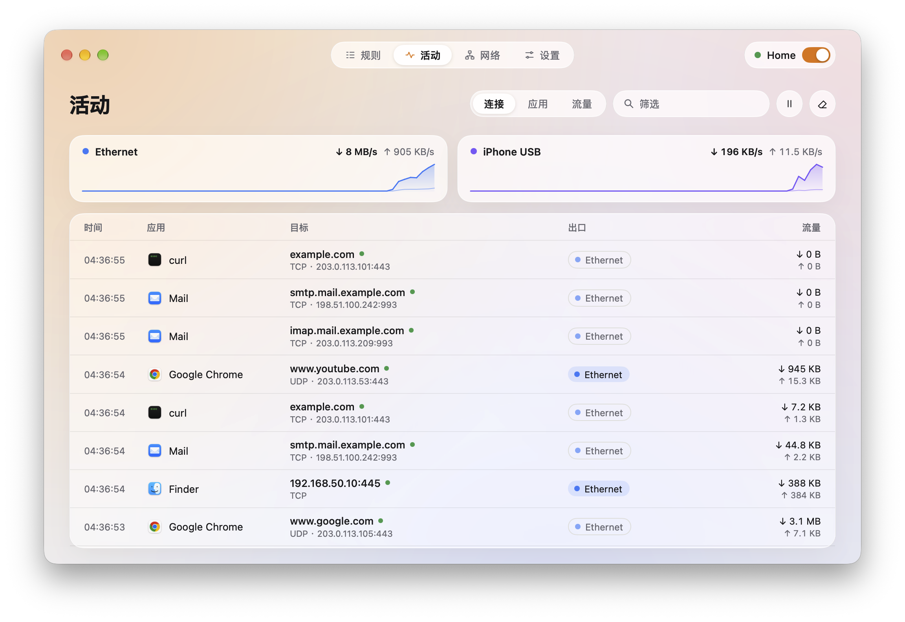
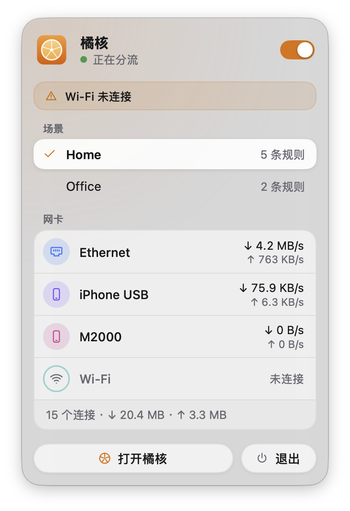

<div align="center">


# 橘核 Pith

### 给 Mac 上的每个应用指定出口网卡

**比如微信走手机热点，公司内网走有线，其他照旧。**<br>
按应用、域名或 IP 写几条规则，新连接就从指定的网卡出去，<br>
每个连接实际走了哪张网卡，都记在「活动」页里。

[](LICENSE) [](https://github.com/Kel077/pith/stargazers) <a href="https://awesomemygo.dev/apps/pith"></a> [](https://linux.do)<br>
  

**[架构说明（英文）](docs/ARCHITECTURE.md)** &nbsp;·&nbsp; **[设计说明（英文）](docs/DESIGN.md)** &nbsp;·&nbsp; [English](README.md) · **简体中文**

<br>



</div>

<br>

## 谁会用得上

Mac 可以同时连着有线、Wi-Fi 和手机热点，但系统几乎所有流量都只走其中一个。有了橘核，你可以按应用、按目标地址来分配：

- **给某个应用单独换条线路**：微信走手机热点，下载工具走另一条宽带，其他应用照常。
- **内网固定走有线**：公司内网、家里的 NAS 走有线，上网走 Wi-Fi。
- **一条线不通就换一条**：规则里可以按顺序排好几张网卡，前一张连不上就自动换下一张；全都不通时，可以交还给系统，也可以直接断开。
- **看得到每个连接的去向**：来自哪个应用、连到哪里、按哪条规则、最后从哪张网卡出去。
- **让其他设备也走这台 Mac**：笔记本、手机和平板可以经它的某张网卡出去，也可以按它的规则走。

如果你的 Mac 经常同时连着好几个网络，又想让某些应用固定走其中一个，橘核正好用得上。平时只连一个网络的话，就不需要它了。

支持搭载 Apple 芯片的 Mac，需要 macOS 13 或更高版本。

## 快速上手

**1 · 安装。** 到 [Releases](https://github.com/Kel077/pith/releases/latest) 下载橘核，拖进「应用程序」。橘核用的是临时签名，没有经过 Apple 公证，所以第一次打开时 macOS 会拦下来：打开「系统设置 → 隐私与安全性」，在橘核那一条点「仍要打开」，再确认一次。

<sub>想校验下载的文件，可以在放着这些文件的文件夹里运行 `shasum -a 256 -c SHA256SUMS --ignore-missing`，或者 `gh attestation verify <文件> -R Kel077/pith`。</sub>

也可以装好 [Go](https://go.dev/dl/) 1.27 或更高版本，自己编译：

```sh
git clone https://github.com/Kel077/pith.git
cd pith
make helper                # 先编译负责分流的后台助手
go run ./cmd/pith          # 启动橘核，图标出现在菜单栏
go run ./cmd/pith -mock    # 用模拟数据看看界面，不会安装任何东西
```

<sub>第一次打开分流时，macOS 会让你输入管理员密码，用来安装负责分流的后台助手。不想用了，随时可以在「设置 → 后台助手」里卸载。</sub>

**2 · 加规则。** 在「规则」页点「添加规则」，选好应用，填上目标（域名、IP 或网段），再按先后顺序选网卡。

**3 · 打开分流。** 打开菜单栏或窗口右上角的开关，新连接就按规则走了。想确认效果，去「活动」页看看每个连接走的是哪张网卡。

## 工作原理



打开分流后，后台助手会通过一张 utun 虚拟网卡接管新建立的连接。它先从内核的 socket 表查出连接属于哪个应用，再从 TLS SNI、HTTP Host 或 DNS 里认出域名，然后按规则把连接绑到对应的网卡上重新发出去，在两头之间转发数据。关掉分流，它对路由表做的改动会全部撤回。

橘核不需要 Apple 开发者账号，也不用装系统扩展。只有安装、更新或卸载后台助手时要输管理员密码；只升级 App、后台助手没变的话，不用再输。

## 能做什么

### 规则

每条规则读起来就是一句话：哪些应用、访问哪些地址、按什么顺序走哪些网卡。

| | |
| :-- | :-- |
| **应用** | 可以是全部应用，也可以只挑几个。应用自带的辅助进程，以及替它联网的系统进程（比如 Safari 的 WebKit 网络进程），也算在这个应用名下 |
| **目标** | 域名（可以选择是否包括子域名）、IP 地址和网段，IPv4、IPv6 都行；一次粘贴好几行就能批量添加 |
| **网卡** | 按顺序排好：前一张连不上就换下一张，如果允许，最后交给系统默认网络 |
| **拦截** | 拦截规则总是最优先；其他规则从上往下比对，第一条对上的生效，拖动可以调整顺序 |
| **检查** | 被上面的规则完全盖住、永远轮不到的规则会被标出来；「检查」能告诉你某个连接会对上哪条规则、现在会走哪张网卡 |

规则保存后马上生效。已经打开的连接，如果按新规则要换网卡或者被拦截，会被断开，应用会按新规则重新连接；不受影响的连接照常保持。

### 场景

在家一套规则，在公司另一套，在菜单栏里就能切换。正在用的场景旁边有个绿点。

### 活动

<table>
<tr>
<td width="68%"></td>
<td width="32%"></td>
</tr>
</table>

| | |
| :-- | :-- |
| **连接** | 实时列出每个连接，最新的在最上面：应用、目标、协议，以及实际走的网卡。按规则走的网卡用它自己的颜色标出，走系统默认的用浅色标签。右键就能直接给这个连接加规则 |
| **应用** | 按应用统计流量，还能看到每个应用用过哪些网卡 |
| **流量** | 每张网卡最近 1 小时、24 小时、7 天的流量 |

### 网络

每张网卡的地址、路由器和 DNS 都能看到；可以测速，看延迟、下载和上传速度，顺便查公网 IP；也可以让每张网卡分别去连同一台服务器，比较哪条线更快。网卡可以改名。

有些热点还能显示信号、更换公网 IP。目前只支持下表里的型号，都在真机上测过：

| 热点 | 不填密码 | 填了管理密码 |
| :-- | :-- | :-- |
| Inseego 5G MiFi M2000 | 信号格数，用的是 5G 还是 LTE | 还能看到所在频段（n41、n71 这些）、信号强度和运营商，并能「更换热点 IP」 |

点「更换热点 IP」，热点会重新连接运营商，一般会拿到新的公网 IP。管理密码由橘核存在你的钥匙串里。其他热点（包括 Inseego 的其他型号）照样可以当普通网卡用来分流，只是没有这些额外功能。

填了管理密码以后，路由器也能更换公网 IP。目前只支持下表里的型号，在真机上测过：

| 路由器 | 填了管理密码 |
| :-- | :-- |
| Verizon Router CHR30A-R（Fios） | 在它所连的有线或 Wi-Fi 网卡上显示型号，并能「更换 IP」 |

点「更换 IP」，路由器会放弃当前的公网 IPv4 地址，再向 Verizon 申请一个。如果拿回的还是原来的地址，橘核会等更久再试，最多三次；实测一次用了 34 秒。这期间 Mac 改走另一个已连接的网络，由 macOS 设为默认；规则会跳过这张网卡，走这张网卡的本地代理会直接拒绝连接，不会改走别的网卡。每试一次，路由器下的其他设备都会断网几秒，经旧地址的连接也会断开。公网 IPv6 地址不会变。要用这个功能，需要另有一个能上网的网络，并且装好后台助手，由它在这期间把那个网络设为默认。

### 本地代理

本地代理是 Mac 上的一个端口，能设代理的应用和浏览器都可以用，开不开分流都行。同一个端口支持 SOCKS5 和 HTTP，只支持 TCP。每个端口的出口有三种：

| | |
| :-- | :-- |
| **一张网卡** | 所有连接都走这张网卡。网卡不可用时连接直接失败，不会改走别的网卡 |
| **一个场景的规则** | 每个连接按这个场景的规则走：对上拦截规则的会被拒绝，对上其他规则的按顺序试规则里的网卡，没有对上规则的交给系统。指定了应用的规则不参与，因为代理分不清连接来自哪个应用 |
| **另一个代理** | 经另一台 Mac 上橘核共享的端口出去，也可以是任何不带密码的 SOCKS5 代理，填它的主机和端口 |

### 其他设备

点本地代理上的「共享给其他设备」，「设备」里列出的设备就能通过这台 Mac 的地址使用它。可以是另一台电脑，也可以是在 Wi-Fi 设置里只能填 HTTP 代理的手机和平板。设备按 IPv4 地址或网段填写。不在列表里的设备会被拒绝，并出现在「设备」里，点「允许」就能加进列表。每台设备都显示当前的连接数和流量。

另一台 Mac 可以保留自己的端口：在它的橘核里，把本地代理的出口选成「另一个代理…」，填这台 Mac 共享的端口，那边的应用仍然连 `127.0.0.1`。

共享不需要密码。能用上列表里地址的设备都能用这个端口，并能访问这台 Mac 经这个出口能访问的一切，包括它的局域网，但访问不到只对这台 Mac 自己开放的服务。请只在信得过的网络里共享。共享的代理不能把同一台 Mac 上的代理当出口。

### 给脚本用

本地代理的端口还会回答两个直接发给它的普通 HTTP 请求，方便脚本和控制浏览器的工具使用：

| | |
| :-- | :-- |
| `GET /` | 用 JSON 返回这个端口的出口、是否在线，以及外面看到的公网 IP |
| `POST /change-ip` | 更换这个公网 IP，效果和「网络」页的「更换热点 IP」「更换 IP」一样，换完后返回新旧地址 |

```sh
curl http://127.0.0.1:1081/
curl -X POST http://127.0.0.1:1081/change-ip
```

能用这个端口的应用和设备都可以发 `GET /`。橘核查到公网 IP 后会一直记着，到网络变化时才重查；用 `GET /?max-age=60`，地址超过一分钟就会重查。

`POST /change-ip` 默认会被拒绝。在代理那一行点亮带两个箭头的按钮「允许应用和设备更换它的 IP」以后，这台 Mac 上的所有应用，以及这个代理共享给的所有设备，都能更换这个 IP。路由器更换 IP 时，它下面的所有设备会断网几秒，打开之前想一想还有谁在用这个网络。

出口是另一台 Mac 上橘核的代理，会把这两个请求转给那台 Mac；换 IP 需要两边都点亮那个按钮。它那一行会显示那台 Mac 用的网络和公网 IP；那台 Mac 允许的话，旁边还有「更换 IP」。

网页用不了这两个请求：浏览器里的网页发来的，橘核一律拒绝。

### 其他

- **安全启动**（默认开启）：打开分流后如果断网了，橘核会自动撤回。
- **启动时恢复分流**、**退出后继续分流**、**登录时打开**，菜单栏还能显示实时网速。
- 单个场景的规则可以**导入、导出**，也能把全部配置备份成一个文件。
- 支持**简体中文和英文**，浅色、深色模式都有。

## 和 VPN、iCloud 专用代理一起用

- **只连自己设备的 VPN**（比如没开出口节点的 Tailscale）不受影响：它的流量照样走 VPN，橘核不碰它的地址和路由。分流开着时 VPN 断开再重连，分流照常进行：发给 VPN 的流量不会改从别的网卡出去，其他应用也照常联网。
- **接管全部流量的 VPN**（比如 Tailscale 的出口节点）还没有和橘核一起测过。
- **iCloud 专用代理**会让 Safari 经过 Apple 的中继服务器上网，橘核只看得到中继，看不到真正访问的网站，所以域名规则和 IP 规则管不到 Safari 的浏览。想按网站给 Safari 分流，就关掉专用代理。

## 断网了怎么办

打开分流后如果马上断网，安全启动会自己撤回。如果还是上不了网：

1. **在菜单栏关掉「分流」**，不需要密码。开着「退出后继续分流」时，光退出橘核是不够的。
2. **卸载后台助手**：「设置 → 后台助手 → 卸载…」，输入管理员密码。连接记录和流量统计会一起删掉，规则还在。
3. **橘核没反应时**，先强制退出它（⌥⌘⎋），再把下面这段粘贴到「终端」里运行。它会要你输入管理员密码（输入时屏幕上不显示），只让 macOS 停掉橘核的后台助手，别的什么都不做：不运行橘核的任何程序，不删文件，也不改路由。之后重新打开橘核，按第 2 步卸载后台助手；如果已经把橘核删了，先重新装上。在那之前，Mac 重启后后台助手还会再启动。

<details>
<summary>在终端里停掉后台助手</summary>

```sh
sudo /bin/sh <<'PITH_STOP'
set -eu
export LC_ALL=C
service='system/io.github.kel077.pith.helper'
fail() {
  printf '%s\n' 'Pith could not be stopped or its state could not be verified.' \
    'Keep any remaining files and capture journal. Stop here and open an issue:' \
    'https://github.com/Kel077/pith/issues/new' >&2
  exit 1
}
if state=$(/bin/launchctl print "$service" 2>&1); then
  /bin/launchctl bootout "$service" || fail
  printf '%s\n' 'macOS was asked to stop the Pith helper.'
else
  case "$state" in
    *'Could not find service "io.github.kel077.pith.helper"'*)
      printf '%s\n' 'Pith is not registered with launchd; nothing was changed.' ;;
    *) fail ;;
  esac
fi
printf '%s\n' 'No manual file or route deletion was performed.' \
  'Finish removal using the Uninstall action in Settings in a verified copy of Pith.'
PITH_STOP
```

如果它报错，或者卸载后台助手后还是上不了网，就停在那里，并[提一个 issue](https://github.com/Kel077/pith/issues/new?template=bug.yml)。后台助手的文件记录着橘核改过什么，请留着，但不要公开贴出来。不要自己手动删路由。

</details>

## 隐私

橘核只看连接要去哪：地址、端口，以及从 TLS SNI、HTTP Host 或 DNS 里认出的主机名。传输的内容它一概不碰，不解密，也不装证书。规则、连接记录和流量统计都只存在你自己的 Mac 上，记录保留几天由你在设置里定。

橘核自己主动联网只有一种情况：开着「安全启动」时，每次打开分流，后台助手会和 api.ipify.org 建立一次 TLS 连接，确认还能上网，不发送任何请求内容。其余都是你自己操作时才发生：在「网络」页点测速，会从 [Cloudflare 测速](https://speed.cloudflare.com) 下载 25 MB、上传 8 MB，并由它告知公网 IP；更换热点或路由器的 IP 前后，会访问 [ipify](https://www.ipify.org) 查公网 IP；脚本或另一台 Mac 上的橘核向本地代理的端口问公网 IP 时，也会查一次；「连通性测试」会去连你填的地址。填了热点或路由器的管理密码以后，「网络」页开着的时候，橘核会读取设备自己的管理页面，这只在你的局域网里进行。本地代理的端口第一次被问到自己的情况时，橘核也会看一次这个网络的路由器，判断能不能给它换 IP。

## 文档

| | |
| :-- | :-- |
| **[架构说明](docs/ARCHITECTURE.md)** | App、后台助手和分流引擎各管什么，彼此怎么通信（英文） |
| **[设计说明](docs/DESIGN.md)** | 界面的设计原则、配色和各个页面（英文） |
| **[后台助手](internal/helper/README.md)** | 安装后台助手会动到哪些地方，以及它的 socket 接口（英文） |
| **[客户端](internal/client/README.md)** | 界面背后对接的后端（英文） |

## 许可证

[MIT](LICENSE)
