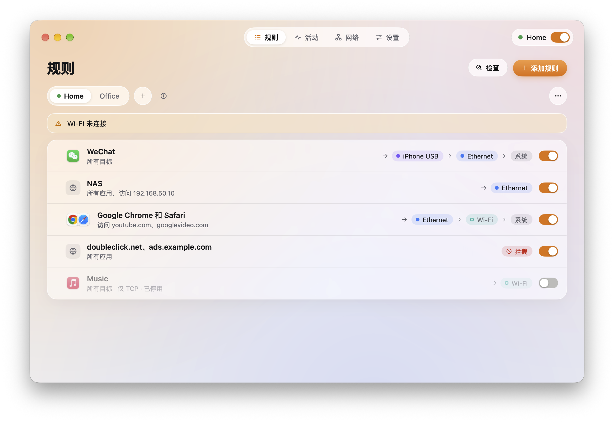
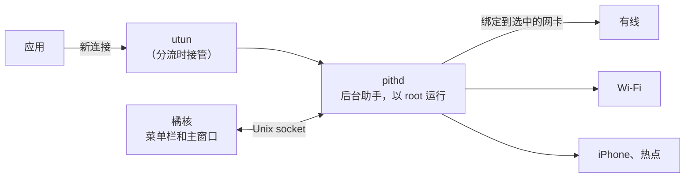
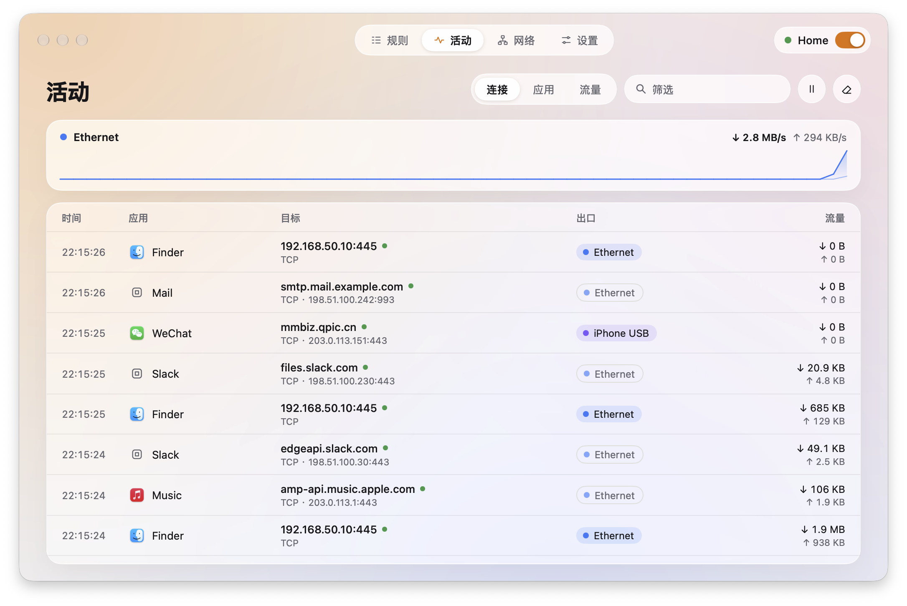
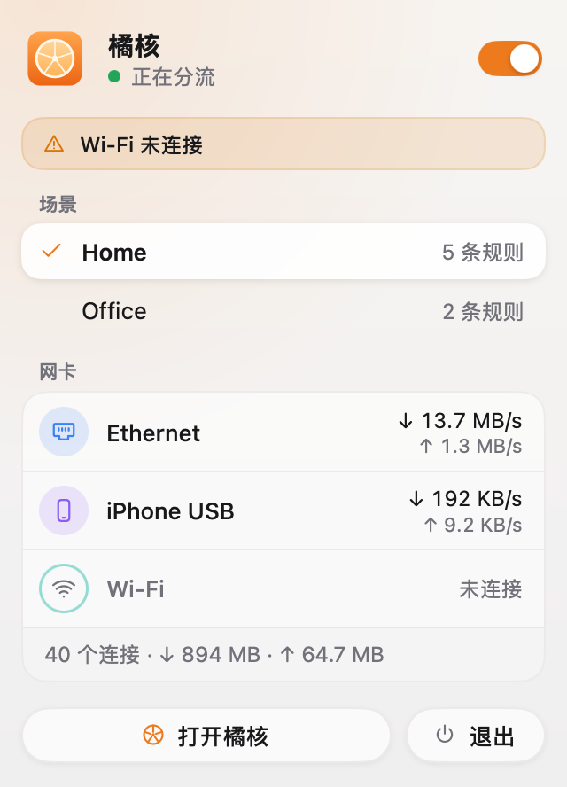

<div align="center">


# 橘核 Pith

### 哪个应用走哪张网卡，由你决定。

**聊天软件走手机热点，公司内网走有线，其余照常。**<br>
按应用、域名或 IP 设置规则，把新连接送到你选的网卡上，<br>
还能看到每个连接实际走的是哪张网卡。

[](LICENSE) [](https://github.com/Kel077/pith/stargazers)<br>
  

**[架构（英文）](docs/ARCHITECTURE.md)** &nbsp;·&nbsp; **[设计（英文）](docs/DESIGN.md)** &nbsp;·&nbsp; [English](README.md) · **简体中文**

<br>



</div>

<br>

## 橘核适合你吗？

Mac 可以同时连着有线、Wi-Fi 和手机热点，但 macOS 几乎把所有连接都交给其中一张网卡。橘核让你按应用、按目标来选：

- **让某个应用走另一张网卡**：聊天软件走热点，下载工具走第二条线路，其余不变。
- **内网留在有线上**：公司内网或 NAS 走有线，其他走 Wi-Fi。
- **可以回退，也可以不回退**：规则按顺序尝试网卡；都连不上时交回系统默认网络，也可以设成严格模式，直接失败。
- **看清每个连接去了哪**：每个连接都显示应用、目标、生效的规则，以及实际走的网卡。

如果你的 Mac 同时连着不止一张网，又希望某些应用固定走其中一张，橘核就适合你。如果你只用一张网，就用不着它。

需要搭载 Apple 芯片的 Mac，macOS 13 或更新版本。

## 快速开始

**1 · 编译。** 橘核还没有正式发布。安装 [Go](https://go.dev/dl/) 1.27 或更新版本后：

```sh
git clone https://github.com/Kel077/pith.git
cd pith
go run ./cmd/pith          # 运行 App，出现在菜单栏
go run ./cmd/pith -mock    # 用模拟数据预览界面，什么都不安装
```

<sub>第一次打开分流时，macOS 会要求输入管理员密码，用来安装负责分流的后台助手。随时可以在「设置 → 后台助手」里卸载。</sub>

**2 · 添加规则。** 在「规则」页点「添加规则」：选应用、填目标（域名、IP 或网段），再按顺序选要尝试的网卡。

**3 · 打开分流。** 在菜单栏或侧边栏打开开关。新连接立刻按规则走，「活动」页能看到每个连接去了哪。

## 工作原理



分流打开时，后台助手通过 utun 虚拟网卡和用户态网络栈接管新连接：从内核的 socket 表找出连接属于哪个应用，从 TLS SNI、HTTP Host 或 DNS 识别域名，再按规则把连接绑定到选中的网卡重新发出，并转发数据。关闭分流后，它加到路由表里的内容会全部撤掉。橘核不需要 Apple 开发者账号，也不需要系统扩展，只在安装助手时由 macOS 要求输入一次密码。

## 功能

### 规则读起来是一句话

每条规则说的就是它做的事：这些应用、访问这些地方，按这个顺序走这些网卡。

| | |
| :-- | :-- |
| **应用** | 所有应用，或你选的应用。应用的辅助进程、替它联网的系统服务（WebKit、nsurlsessiond）也会一并匹配 |
| **目标** | 域名（可选是否包含子域名）、IP 地址和 CIDR 网段，支持 IPv4 和 IPv6；粘贴一串可以一次添加多个 |
| **网卡** | 一个有序列表：前一张连不上时用下一张，允许的话最后交回系统网络 |
| **拦截** | 拦截规则总是优先；其余从上往下，第一条匹配的规则生效，拖动即可调整顺序 |
| **检查** | 被前面规则完全覆盖、永远不会生效的规则会标出来；「检查」能告诉你一个连接会命中哪条规则、现在会走哪张网卡 |

保存后规则立即对新连接生效，已经建立的连接保持原来的路线。

### 场景

家里一套规则，公司一套规则。在菜单栏切换，正在运行的场景带一个绿点。

### 活动

<table>
<tr>
<td width="68%"></td>
<td width="32%"></td>
</tr>
</table>

| | |
| :-- | :-- |
| **连接** | 实时列表，最新的在上：应用、目标、协议，规则选中的网卡用它的颜色显示，系统默认路由的用浅色标签。右键可以直接为某个连接建规则 |
| **应用** | 按应用汇总流量，以及各自用过的网卡 |
| **流量** | 每张网卡最近 1 小时、24 小时、7 天的流量 |

### 网络

列出每张网卡的地址、路由器和 DNS；测试延迟和公网 IP；还能分别从每张网卡连接同一个服务器做对比。网卡可以重命名。

### 其他

- **安全启动**：开始分流后如果电脑断网，橘核会自动撤销。
- **启动时恢复分流**、**退出后继续分流**、**登录时打开**，以及在菜单栏显示下载速度。
- **导入导出**单个场景的规则，或者备份全部配置。
- **简体中文和英文**，浅色和深色模式。

## 隐私

橘核只读连接要去哪里：地址、端口，以及从 TLS SNI、HTTP Host 或 DNS 得到的主机名，从不读取传输内容，不解密，也不安装证书。规则、连接日志和流量统计只保存在你的 Mac 上，日志按设置里的天数保留。橘核不会主动向任何地方发送数据；只有你在「网络」页手动测试时，才会访问 [ipify](https://www.ipify.org) 来获取网卡的公网 IP。

## 文档

| | |
| :-- | :-- |
| **[架构](docs/ARCHITECTURE.md)** | App、后台助手和引擎，以及它们之间如何通信（英文） |
| **[设计](docs/DESIGN.md)** | 界面的原则、配色和各个页面（英文） |
| **[后台助手](internal/helper/README.md)** | 安装助手会改动哪些内容，以及它的 socket（英文） |
| **[客户端](internal/client/README.md)** | 界面所对接的后端（英文） |

## 许可

[MIT](LICENSE)
