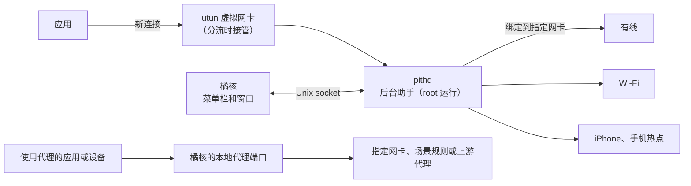

<div align="center">


# 橘核 Pith

### 给 Mac 上的每个应用指定出口网卡

**比如微信走手机热点，公司内网走有线，其他照旧。**<br>
按应用、域名或 IP 写几条规则，新连接就从指定的网卡出去，<br>
可以在「活动」页查看分流接管的连接实际走了哪张网卡。

[](LICENSE) [](https://github.com/Kel077/pith/stargazers) <a href="https://awesomemygo.dev/apps/pith"></a> [](https://linux.do)<br>
  

**[架构说明（英文）](docs/ARCHITECTURE.md)** &nbsp;·&nbsp; **[设计说明（英文）](docs/DESIGN.md)** &nbsp;·&nbsp; [English](README.md) · **简体中文**

<br>


</div>

<br>

## 谁会用得上

Mac 可以同时连着有线、Wi-Fi 和手机热点，但系统几乎所有流量都只走其中一个。有了橘核，你可以按应用、按目标地址来分配：

- **给某个应用单独换条线路**：微信走手机热点，下载工具走另一条宽带，其他应用照常。
- **内网固定走有线**：公司内网、家里的 NAS 走有线，上网走 Wi-Fi。
- **一条线不通就换一条**：规则里可以按顺序排好几张网卡，前一张连不上就自动换下一张；全都不通时，可以交还给系统，也可以直接断开。
- **看得到每个连接的去向**：来自哪个应用、连到哪里、按哪条规则、最后从哪张网卡出去。
- **让其他设备也走这台 Mac**：笔记本、手机和平板可以经它的某张网卡出去，也可以按它的规则走。

支持搭载 Apple 芯片的 Mac，需要 macOS 13 或更高版本。

## 快速上手

**1 · 安装。** 从 [Releases](https://github.com/Kel077/pith/releases/latest) 下载橘核，拖进「应用程序」后打开。橘核使用临时签名。若 macOS 拦住首次启动，在「系统设置 → 隐私与安全性」里找到橘核，点「仍要打开」并确认。

<sub>校验下载文件时，把它和 `SHA256SUMS` 放在同一目录，运行 `shasum -a 256 -c SHA256SUMS --ignore-missing`。要验证文件的构建来源，可运行 `gh attestation verify <文件> -R Kel077/pith`。</sub>

更新日志中「Unreleased」下的功能可以从源码编译。在 Apple 芯片的 Mac 上装好 Go 1.27 和 Command Line Tools，然后运行以下命令。[更新日志](CHANGELOG.md#unreleased) · [构建说明](docs/BUILDING.md)

```sh
git clone https://github.com/Kel077/pith.git
cd pith
make build
open build/darwin-arm64/Pith.app
```

**2 · 添加规则。** 在「规则」页点「添加规则」。可以指定应用、目标地址，也可以两者都指定。按尝试顺序选好网卡。

**3 · 打开分流。** 使用菜单栏或窗口右上角的开关。第一次打开时，macOS 会要求输入管理员密码来安装后台助手。在「活动」页可以看到新连接实际走了哪张网卡。

如果只想给一个浏览器设代理，打开「设置 → 本地代理 → 添加代理」，把显示的地址和端口填进浏览器的代理设置。这种用法可以关着分流。

## 工作原理



打开分流后，后台助手通过 utun 虚拟网卡接管连接。它从内核的 socket 表查出所属应用，再按规则选择出口网卡。关掉分流后，助手会移除为接管流量而添加的路由。本地代理端口由菜单栏应用提供。橘核无需安装系统扩展。升级应用时，如果后台助手和原来相同，就不需要管理员授权。

## 能做什么

### 规则和场景

| 规则选项 | 用法 |
| :-- | :-- |
| **应用** | 可以匹配所有应用，也可以指定应用或命令行程序。对于辅助进程和代应用联网的系统进程，橘核会按 macOS 提供的信息识别所属应用。 |
| **目标** | 可以填单个域名、域名及其子域名、IPv4 或 IPv6 地址、CIDR 网段。一次可以粘贴多个目标，也可以限定只匹配 TCP 或 UDP。 |
| **分流和拦截** | 拦截规则优先。其他规则从上往下匹配，命中的第一条规则按顺序尝试网卡。全都连不上时，可以断开连接，也可以交给 macOS 选路。 |
| **排序和检查** | 拖动规则可以调整顺序。被前一条完全覆盖的规则会有提示。点「检查」，可以预览某个应用访问某个目标时会命中哪条规则，以及当前可用的网卡。 |

家里和办公室可以各用一套规则。在「规则」页可以创建、复制、改名或删除场景。绿点标出正在分流的场景。在菜单栏里可以切换场景，也可以让当前场景继续分流，另开一个场景编辑。场景菜单支持导入和导出规则。

正在使用的场景一经保存，新连接就按新规则走。对于橘核接管的已有连接，如果分流决定有变，橘核会断开连接，让应用重新连接。

### 活动

<table>
<tr>
<td width="68%"></td>
<td width="32%"></td>
</tr>
</table>

| 视图 | 显示内容 |
| :-- | :-- |
| **连接** | 可以查看分流接管的连接，包括应用、目标、协议、命中的规则、实际网卡和流量。列表可以筛选或暂停刷新。右键点连接可以给应用或目标添加规则。 |
| **应用** | 按应用比较流量，也能看到每个应用用过哪些网卡。 |
| **流量** | 按网卡比较最近一小时、一天或一周的流量。菜单栏面板显示各网卡当前的上传和下载速率。 |

### 网络

「网络」页列出已连接的网卡、地址、路由器和 DNS 服务器，并标出系统默认网卡。双击网卡名称，可以给它取个在橘核里显示的名字。

| 测试 | 结果 |
| :-- | :-- |
| **测速** | 显示延迟（毫秒）、下载和上传速率（Mbps），以及 Cloudflare 返回的公网 IP 和数据中心。每张网卡完整测一次约用 33 MB 流量，下载 25 MB，上传 8 MB。「全部测速」会逐张测试已连接的网卡。 |
| **连通性测试** | 输入主机和端口，例如 `example.com:443`。橘核从各张已连接的网卡分别建立 TCP 连接，显示耗时和目标地址，失败时显示原因。 |

这两项测试的 DNS 查询和实际连接都走被测网卡。如果网卡的 DNS 服务器无法回答，橘核可以通过同一张网卡尝试 Mac 的 DNS 配置中可用于其他网络的服务器。

#### 更换公网 IP

| 设备 | 网络页上的操作 |
| :-- | :-- |
| **Inseego 5G MiFi M2000** | 可以看到信号格数和网络类型。输入热点管理密码解锁后，可以查看运营商、频段和信号强度。点「更换热点 IP」，热点会重新连接运营商。如果热点报告了连接时长，橘核会等到新的蜂窝连接建立，再查询公网地址。 |
| **Verizon Router CHR30A-R（Fios）** | 在有线或 Wi-Fi 网卡上可以看到路由器地址和型号。点「更换 IP」后输入路由器管理密码。解锁后再点「更换 IP」，路由器会重新申请公网 IPv4 租约。 |

路由器续租需要后台助手，还需要另一张能上网的网卡。橘核会等 macOS 切到可用的备用网络，再让路由器释放租约。固定走原网卡的本地代理会断开已有连接。路由器每次释放租约时，下面的设备都会暂时断网。如果 Verizon 分回原地址，橘核会再试，最多三次。三次尝试分别等 5 秒、20 秒和 60 秒后再申请地址。此操作只续租 IPv4。无论使用热点还是路由器，运营商都有可能分回原地址。

设备管理密码保存在 macOS 钥匙串中。其他型号的设备仍可作为普通网卡参与分流。

### 本地代理

打开「设置 → 本地代理 → 添加代理」。橘核从 `1080` 起建议端口号，双击显示的地址可以改端口。每个 TCP 端口都支持 SOCKS5、HTTP CONNECT 和普通 HTTP 代理。只要橘核运行就能使用，也可以不装后台助手。

| 出口 | 连接怎么走 |
| :-- | :-- |
| **一张网卡** | 所有连接都走这张物理网卡，网卡断开后连接就会失败。交给代理的域名也通过这张网卡解析。 |
| **规则：某个场景** | 可以选任何已保存的场景。代理按目标匹配其中的拦截、网卡顺序和回退规则。未命中的连接由 macOS 选路，指定了应用的规则会跳过。编辑规则会影响新的代理连接。 |
| **另一个代理…** | 转发给无需认证的 SOCKS5 代理，也可以是另一台 Mac 上橘核共享的端口。目标域名由上游代理解析。 |

每一行都显示该端口的连接数和流量。退出橘核会关闭所有本地代理端口，即使打开了「退出后继续分流」也是如此。

### 其他设备

1. 在代理那一行点「共享给其他设备」。在另一台设备上，填入「设备」分组中「本机」旁显示的 IPv4 地址和代理端口。手机或平板可以填在 Wi-Fi 的 HTTP 代理设置里。
2. 点「添加设备」，填入设备的 IPv4 地址或 CIDR 网段。也可以先让设备尝试连接一次，再点被拒绝的设备旁边的「允许」。所有共享端口使用同一份设备列表。
3. 如果希望另一台 Mac 上的应用继续连接各自的本地端口，在那台 Mac 的橘核里把出口选成「另一个代理…」，填入共享端的地址和端口。

共享端口按来源 IP 识别设备。请在可信网络上允许设备连接。获准设备可以访问出口所在局域网里的其他主机。橘核会检查目标是否属于本机网卡。使用上游代理时，由上游所在的机器解析域名。共享端口的上游必须在另一台机器上。

### 脚本接口

下面的 HTTP 请求直接发给代理端口。请把 `1080` 换成设置里显示的端口。

```sh
curl --noproxy '*' 'http://127.0.0.1:1080/?max-age=60'
curl --noproxy '*' -X POST http://127.0.0.1:1080/change-ip
```

| 请求 | 返回的 JSON |
| :-- | :-- |
| `GET /` | 包括出口类型、在线状态、已知公网地址，以及能否请求更换 IP。按场景规则分流的端口没有唯一的公网 IP。`max-age` 指定可接受的地址缓存时间，单位为秒。 |
| `POST /change-ip` | 返回续租前后查到的公网地址。先在该端口打开「允许应用和设备更换它的 IP」，此后所有能使用这个端口的调用方都可以发起续租。 |

如果上游也是橘核，这两个请求会逐级转发。通过脚本换 IP 需要链上的每个端口都开启权限。在橘核界面里直接点上游的「更换 IP」按钮，只需上游允许。同一张网卡收到多个请求时只续租一次。这台 Mac 上的另一张网卡此时会返回 `503` 和 `busy`，等前一次结束即可再试。

访问端口时请使用 IP 地址、`localhost`、不带点的主机名或 `.local` 名称。端口会检查 Host 和浏览器请求头。缓存重试、响应字段、超时和 HTTP 错误见[端口接口说明](docs/ARCHITECTURE.md#requests-to-a-port)。

### MCP 客户端

MCP 客户端可以操作已经打开的橘核。将橘核的可执行文件设为 stdio 服务，启动参数填 `mcp`。如果安装在「应用程序」，可以使用对应客户端的命令。

```sh
claude mcp add pith -- /Applications/Pith.app/Contents/MacOS/Pith mcp
codex mcp add pith -- /Applications/Pith.app/Contents/MacOS/Pith mcp
```

你可以让它检查某个应用会走哪张网卡、测试网速或查看流量。它也能添加规则、调整规则顺序、管理场景、切换分流、配置代理、允许设备连接，或请求更换公网 IP。配置修改会显示在窗口里。续租有时需要等几分钟。

本机程序需要以你的用户身份运行，才能通过 Unix socket 调用橘核。要操作远程 Mac，可以通过 SSH 在那台 Mac 上运行同一条服务命令。工具改动分流时橘核不会再弹窗确认，调用权限可以在 MCP 客户端里设置。安装后台助手、输入设备密码和修改设置仍在橘核界面中完成。[工具名称和连接方式](docs/ARCHITECTURE.md#tools-for-agents)

### 设置

「安全启动」默认开启。打开分流后，橘核会检查能否联网，失败时撤回这次启动。设置里还可以调整 IPv6 分流、域名识别、连接记录保留时间、登录时打开、启动时恢复分流、退出后继续分流，以及在菜单栏显示下载速率。

「备份全部配置」可以导出和恢复场景、规则、网卡别名、本地代理、允许的设备和各项设置。橘核支持简体中文和英文，外观跟随系统的浅色或深色模式。

## 和 VPN、iCloud 专用代理一起用

- **只连自己设备的 VPN**（比如没开出口节点的 Tailscale）不受影响：它的流量照样走 VPN，橘核不碰它的地址和路由。分流开着时 VPN 断开再重连，分流照常进行：发给 VPN 的流量不会改从别的网卡出去，其他应用也照常联网。
- **接管全部流量的 VPN**（比如 Tailscale 的出口节点）还没有和橘核一起测过。
- **iCloud 专用代理**会让 Safari 经过 Apple 的中继服务器上网，橘核只看得到中继，看不到真正访问的网站，所以域名规则和 IP 规则管不到 Safari 的浏览。想按网站给 Safari 分流，就关掉专用代理。

## 断网了怎么办

打开分流后如果马上断网，安全启动会自己撤回。如果还是上不了网：

1. **在菜单栏关掉「分流」**，不需要密码。开着「退出后继续分流」时，光退出橘核是不够的。
2. **卸载后台助手**：「设置 → 后台助手 → 卸载…」，输入管理员密码。连接记录和流量统计会一起删掉，规则还在。
3. **橘核没反应时**，先强制退出它（⌥⌘⎋），再把下面这段粘贴到「终端」里运行。它会要你输入管理员密码（输入时屏幕上不显示），只让 macOS 停掉橘核的后台助手，别的什么都不做：不运行橘核的任何程序，不删文件，也不改路由。之后重新打开橘核，按第 2 步卸载后台助手；如果已经把橘核删了，先重新装上。在那之前，Mac 重启后后台助手还会再启动。

<details>
<summary>在终端里停掉后台助手</summary>

```sh
sudo /bin/sh <<'PITH_STOP'
set -eu
export LC_ALL=C
service='system/io.github.kel077.pith.helper'
fail() {
  printf '%s\n' 'Pith could not be stopped or its state could not be verified.' \
    'Keep any remaining files and capture journal. Stop here and open an issue:' \
    'https://github.com/Kel077/pith/issues/new' >&2
  exit 1
}
if state=$(/bin/launchctl print "$service" 2>&1); then
  /bin/launchctl bootout "$service" || fail
  printf '%s\n' 'macOS was asked to stop the Pith helper.'
else
  case "$state" in
    *'Could not find service "io.github.kel077.pith.helper"'*)
      printf '%s\n' 'Pith is not registered with launchd; nothing was changed.' ;;
    *) fail ;;
  esac
fi
printf '%s\n' 'No manual file or route deletion was performed.' \
  'Finish removal using the Uninstall action in Settings in a verified copy of Pith.'
PITH_STOP
```

如果它报错，或者卸载后台助手后还是上不了网，就停在那里，并[提一个 issue](https://github.com/Kel077/pith/issues/new?template=bug.yml)。后台助手的文件记录着橘核改过什么，请留着，但不要公开贴出来。不要自己手动删路由。

</details>

## 隐私

橘核会读取连接的地址和端口，也可以从 DNS、TLS、HTTP 和 QUIC 识别域名。它不会解密 HTTPS 或安装证书。配置、连接记录和流量统计保存在 Mac 上，连接记录的保留时间可以在设置里调整。

启用「安全启动」时，每次启动分流都会与 ipify 建立一次验证证书的 TLS 连接。「测速」连接 Cloudflare，「连通性测试」连接你输入的主机和端口。换 IP 前后以及代理需要刷新出口地址时，橘核会向 ipify 查询公网地址。上游也是橘核的代理启用后，检查上游状态时也可能自动触发查询。「网络」页会读取局域网里支持的设备，解锁前也能读取路由器型号或热点信号。[网络测试说明](docs/ARCHITECTURE.md#network-tests)

## 文档

| 英文文档 | 内容 |
| :-- | :-- |
| [架构说明](docs/ARCHITECTURE.md) | 分流、DNS、代理、更换公网 IP 和 MCP。 |
| [界面设计](docs/DESIGN.md) | 窗口、菜单栏面板和操作方式。 |
| [构建说明](docs/BUILDING.md) | 编译应用、运行模拟界面和校验安装包。 |
| [客户端](internal/client/README.md) · [后台助手](internal/helper/README.md) · [助手版本](docs/HELPER-VERSIONING.md) | 客户端服务、后台助手通信和更新机制。 |
| [性能](docs/PERFORMANCE.md) | 转发性能测试和测量结果。 |
| [真机测试](docs/ROOT-TEST.md) · [验收计划](docs/NEXT-ACCEPTANCE.md) | 已记录的结果、适用范围和待验证项目。 |
| [更新日志](CHANGELOG.md) | 已发布和未发布的改动。 |

## 许可证

[MIT](LICENSE)
