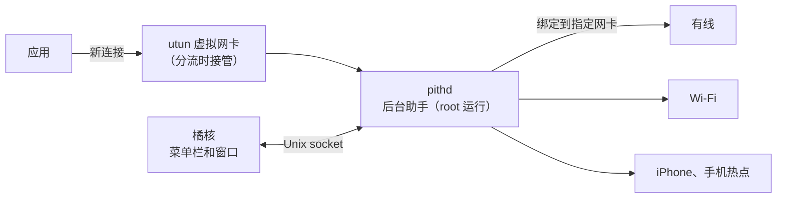

<div align="center">


# 橘核 Pith

### 每个应用走哪条网络，你说了算。

**微信走手机热点，公司内网走有线，其他照旧。**<br>
按应用、域名或 IP 写几条规则，新连接就会从你指定的网卡出去，<br>
每个连接实际走的是哪张网卡，也看得清清楚楚。

[](LICENSE) [](https://github.com/Kel077/pith/stargazers) <a href="https://awesomemygo.dev/apps/pith"></a><br>
  

**[架构说明（英文）](docs/ARCHITECTURE.md)** &nbsp;·&nbsp; **[设计说明（英文）](docs/DESIGN.md)** &nbsp;·&nbsp; [English](README.md) · **简体中文**

<br>


</div>

<br>

## 谁会用得上

Mac 可以同时连着有线、Wi-Fi 和手机热点，但系统默认只走其中一个。有了橘核，你可以按应用、按目标地址来分配：

- **给某个应用单独换条线路**：微信走手机热点，下载工具走另一条宽带，其他应用照常。
- **内网固定走有线**：公司内网、家里的 NAS 走有线，上网走 Wi-Fi。
- **一条线不通就换一条**：规则里可以按顺序排好几张网卡，前一张连不上就自动换下一张；全都不通时，可以交还给系统，也可以直接断开。
- **每个连接走了哪，一看就知道**：来自哪个应用、连到哪里、按哪条规则、最后从哪张网卡出去，都列得清清楚楚。

如果你的 Mac 经常同时连着好几个网络，又想让某些应用固定走其中一个，橘核正好用得上。平时只连一个网络的话，就不需要它了。

支持搭载 Apple 芯片的 Mac，需要 macOS 13 或更高版本。

## 快速上手

**1 · 编译。** 橘核还没有发布安装包，目前需要装好 [Go](https://go.dev/dl/) 1.27 或更高版本，自己编译：

```sh
git clone https://github.com/Kel077/pith.git
cd pith
go run ./cmd/pith          # 启动橘核，图标出现在菜单栏
go run ./cmd/pith -mock    # 用模拟数据看看界面，不会安装任何东西
```

<sub>第一次打开分流时，macOS 会让你输入管理员密码，用来安装负责分流的后台助手。不想用了，随时可以在「设置 → 后台助手」里卸载。</sub>

**2 · 加规则。** 在「规则」页点「添加规则」，选好应用，填上目标（域名、IP 或网段），再按先后顺序选网卡。

**3 · 打开分流。** 打开菜单栏或窗口右上角的开关，新连接马上按规则走。想确认效果，去「活动」页看看每个连接走的是哪张网卡。

## 工作原理



打开分流后，后台助手会通过一张 utun 虚拟网卡接管新建立的连接。它先从内核的 socket 表查出连接属于哪个应用，再从 TLS SNI、HTTP Host 或 DNS 里认出域名，然后按规则把连接绑到对应的网卡上重新发出去，在两头之间转发数据。关掉分流，它对路由表做的改动会全部撤回。

橘核不需要 Apple 开发者账号，也不用装系统扩展，只在第一次安装后台助手时输一次管理员密码。

## 能做什么

### 规则一看就懂

每条规则读起来就是一句话：哪些应用、访问哪些地址、按什么顺序走哪些网卡。

| | |
| :-- | :-- |
| **应用** | 可以是全部应用，也可以只挑几个。应用自带的辅助进程，以及替它联网的系统服务（比如 WebKit、nsurlsessiond），都会一起算进去 |
| **目标** | 域名（可以选择是否包括子域名）、IP 地址和网段，IPv4、IPv6 都行；一次粘贴好几行就能批量添加 |
| **网卡** | 按顺序排好：前一张连不上就换下一张，如果允许，最后交给系统默认网络 |
| **拦截** | 拦截规则总是最优先；其他规则从上往下比对，第一条对上的生效，拖一拖就能调顺序 |
| **检查** | 被上面的规则完全盖住、永远轮不到的规则会被标出来；「检查」能告诉你某个连接会对上哪条规则、现在会走哪张网卡 |

规则改完就对新连接生效，已经建立的连接不受影响。

### 场景

在家一套规则，在公司另一套，在菜单栏一点就能切换。正在用的场景旁边有个绿点。

### 活动

<table>
<tr>
<td width="68%"></td>
<td width="32%"></td>
</tr>
</table>

| | |
| :-- | :-- |
| **连接** | 实时列出每个连接，最新的在最上面：应用、目标、协议，以及实际走的网卡。按规则走的网卡用它自己的颜色标出，走系统默认的用浅色标签。右键就能直接给这个连接加规则 |
| **应用** | 按应用统计流量，还能看到每个应用用过哪些网卡 |
| **流量** | 每张网卡最近 1 小时、24 小时、7 天的流量 |

### 网络

每张网卡的地址、路由器和 DNS 都能看到；可以测延迟、查公网 IP，也可以让每张网卡分别去连同一台服务器，比比哪条线更快。网卡还能改个好记的名字。

如果连的是 Inseego 的热点（比如 MiFi M2000），还能看到它的信号格数、用的是 5G 还是 LTE、在哪个频段（n41、n71 这些），以及运营商。点「更换热点 IP」，热点会重新拨号，换一个新的公网 IP。这需要热点的管理密码，橘核会把它存在你的钥匙串里。

### 其他

- **安全启动**：打开分流后如果断网了，橘核会自动撤回。
- **启动时恢复分流**、**退出后继续分流**、**登录时自动打开**，菜单栏还能显示实时网速。
- 单个场景的规则可以**导入、导出**，也能把全部配置备份成一个文件。
- 支持**简体中文和英文**，浅色、深色模式都有。

## 和 VPN、iCloud 专用代理一起用

- **只连自己设备的 VPN**（比如没开出口节点的 Tailscale）不受影响：它的流量照样走 VPN，橘核不碰它的地址和路由。分流开着时 VPN 断开再重连，分流照常进行：发给 VPN 的流量不会改从别的网卡出去，其他应用也照常联网。
- **接管全部流量的 VPN**（比如 Tailscale 的出口节点）还没有和橘核一起测过。
- **iCloud 专用代理**会让 Safari 经过 Apple 的中继服务器上网，橘核只看得到中继，看不到真正访问的网站，所以域名规则和 IP 规则管不到 Safari 的浏览。想按网站给 Safari 分流，就关掉专用代理。

## 隐私

橘核只看连接要去哪：地址、端口，以及从 TLS SNI、HTTP Host 或 DNS 里认出的主机名。传输的内容它一概不碰，不解密，也不装证书。规则、连接记录和流量统计都只存在你自己的 Mac 上，记录保留几天由你在设置里定。橘核不会自己往外发任何数据；只有你在「网络」页手动点测试时，才会访问 [ipify](https://www.ipify.org) 查公网 IP。填了热点的管理密码以后，「网络」页开着的时候，橘核会读取热点自己的管理页面，这只在你的局域网里进行。

## 文档

| | |
| :-- | :-- |
| **[架构说明](docs/ARCHITECTURE.md)** | App、后台助手和分流引擎各管什么，彼此怎么通信（英文） |
| **[设计说明](docs/DESIGN.md)** | 界面的设计原则、配色和各个页面（英文） |
| **[后台助手](internal/helper/README.md)** | 安装后台助手会动到哪些地方，以及它的 socket 接口（英文） |
| **[客户端](internal/client/README.md)** | 界面背后对接的后端（英文） |

## 许可证

[MIT](LICENSE)
